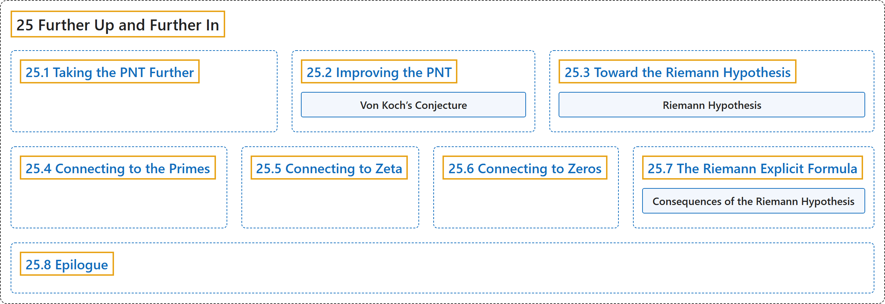

# 25 Further Up and Further In

## Classification

## Glossary

| Term | Definition | 中文翻译 | Source |
|---|---|---|---|
| **25 Further Up and Further In** 更上一层，更进一步 | (No definition) | （无定义） | [Crisman, 2024, chapter 25](https://math.gordon.edu/ntic/ntic/chapter-riemann-hypothesis.html) |
| **[25.1 Taking the PNT Further](25-1-taking-the-pnt-further.md)** 推进素数定理 | (No definition) | （无定义） | [Crisman, 2024, section 25.1](https://math.gordon.edu/ntic/ntic/section-beyond-pnt.html) |
| **[25.2 Improving the PNT](25-2-improving-the-pnt.md)** 改进素数定理 | (No definition) | （无定义） | [Crisman, 2024, section 25.2](https://math.gordon.edu/ntic/ntic/section-improve-pnt.html) |
| **[25.3 Toward the Riemann Hypothesis](25-3-toward-the-riemann-hypothesis.md)** 走向黎曼猜想 | (No definition) | （无定义） | [Crisman, 2024, section 25.3](https://math.gordon.edu/ntic/ntic/section-toward-riemann.html) |
| **[25.4 Connecting to the Primes](25-4-connecting-to-the-primes.md)** 与素数的联系 | (No definition) | （无定义） | [Crisman, 2024, section 25.4](https://math.gordon.edu/ntic/ntic/section-connect-primes.html) |
| **[25.5 Connecting to Zeta](25-5-connecting-to-zeta.md)** 与 ζ 函数的联系 | (No definition) | （无定义） | [Crisman, 2024, section 25.5](https://math.gordon.edu/ntic/ntic/section-connect-zeta.html) |
| **[25.6 Connecting to Zeros](25-6-connecting-to-zeros.md)** 与零点的联系 | (No definition) | （无定义） | [Crisman, 2024, section 25.6](https://math.gordon.edu/ntic/ntic/section-connect-zeros.html) |
| **[25.7 The Riemann Explicit Formula](25-7-the-riemann-explicit-formula.md)** 黎曼显式公式 | (No definition) | （无定义） | [Crisman, 2024, section 25.7](https://math.gordon.edu/ntic/ntic/section-riemann-formula.html) |
| **[25.8 Epilogue](25-8-epilogue.md)** 尾声 | (No definition) | （无定义） | [Crisman, 2024, section 25.8](https://math.gordon.edu/ntic/ntic/section-epilogue-future.html) |

## References

Crisman, K.-D. (2024). *Number theory: In context and interactive* (June 26, 2024 edition). Gordon College. Retrieved October 29, 2026, from <https://math.gordon.edu/ntic/ntic/>
