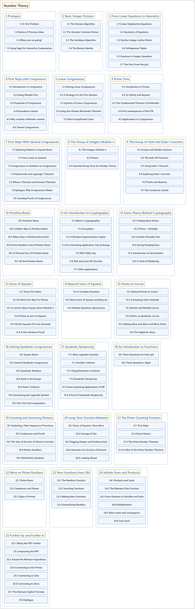

# Number Theory

## Classification

## Glossary

| Term | Definition | 中文翻译 | Source |
|---|---|---|---|
| **Number Theory** 数论 | (No definition) | （无定义） | [Crisman, 2024](https://math.gordon.edu/ntic/ntic/) |
| **[1 Prologue](prologue/index.md)** 序章 | (No definition) | （无定义） | [Crisman, 2024, chapter 1](https://math.gordon.edu/ntic/ntic/chapter-prologue.html) |
| **[2 Basic Integer Division](basic-integer-division/index.md)** 整数除法基础 | (No definition) | （无定义） | [Crisman, 2024, chapter 2](https://math.gordon.edu/ntic/ntic/chapter-basic-integers.html) |
| **[3 From Linear Equations to Geometry](from-linear-equations-to-geometry/index.md)** 从线性方程到几何 | (No definition) | （无定义） | [Crisman, 2024, chapter 3](https://math.gordon.edu/ntic/ntic/chapter-lin-dioph-geom.html) |
| **[4 First Steps with Congruence](first-steps-with-congruence/index.md)** 同余初步 | (No definition) | （无定义） | [Crisman, 2024, chapter 4](https://math.gordon.edu/ntic/ntic/chapter-intro-congruence.html) |
| **[5 Linear Congruences](linear-congruences/index.md)** 线性同余方程 | (No definition) | （无定义） | [Crisman, 2024, chapter 5](https://math.gordon.edu/ntic/ntic/chapter-linear-congruences.html) |
| **[6 Prime Time](prime-time/index.md)** 素数时间 | (No definition) | （无定义） | [Crisman, 2024, chapter 6](https://math.gordon.edu/ntic/ntic/chapter-prime-time.html) |
| **[7 First Steps With General Congruences](first-steps-with-general-congruences/index.md)** 一般同余方程初步 | (No definition) | （无定义） | [Crisman, 2024, chapter 7](https://math.gordon.edu/ntic/ntic/chapter-general-congruences.html) |
| **[8 The Group of Integers Modulo n](the-group-of-integers-modulo-n/index.md)** 模 n 整数群 | (No definition) | （无定义） | [Crisman, 2024, chapter 8](https://math.gordon.edu/ntic/ntic/chapter-integers-mod-n.html) |
| **[9 The Group of Units and Euler’s Function](the-group-of-units-and-eulers-function/index.md)** 单位群与欧拉函数 | (No definition) | （无定义） | [Crisman, 2024, chapter 9](https://math.gordon.edu/ntic/ntic/chapter-units-euler-phi.html) |
| **[10 Primitive Roots](primitive-roots/index.md)** 原根 | (No definition) | （无定义） | [Crisman, 2024, chapter 10](https://math.gordon.edu/ntic/ntic/chapter-primitive-roots.html) |
| **[11 An Introduction to Cryptography](an-introduction-to-cryptography/index.md)** 密码学导论 | (No definition) | （无定义） | [Crisman, 2024, chapter 11](https://math.gordon.edu/ntic/ntic/chapter-cryptography.html) |
| **[12 Some Theory Behind Cryptography](some-theory-behind-cryptography/index.md)** 密码学背后的一些理论 | (No definition) | （无定义） | [Crisman, 2024, chapter 12](https://math.gordon.edu/ntic/ntic/chapter-crypto-theory.html) |
| **[13 Sums of Squares](sums-of-squares/index.md)** 平方和 | (No definition) | （无定义） | [Crisman, 2024, chapter 13](https://math.gordon.edu/ntic/ntic/chapter-square-sums.html) |
| **[14 Beyond Sums of Squares](beyond-sums-of-squares/index.md)** 平方和之外 | (No definition) | （无定义） | [Crisman, 2024, chapter 14](https://math.gordon.edu/ntic/ntic/chapter-beyond-squares.html) |
| **[15 Points on Curves](points-on-curves/index.md)** 曲线上的点 | (No definition) | （无定义） | [Crisman, 2024, chapter 15](https://math.gordon.edu/ntic/ntic/chapter-points-on-curves.html) |
| **[16 Solving Quadratic Congruences](solving-quadratic-congruences/index.md)** 解二次同余方程 | (No definition) | （无定义） | [Crisman, 2024, chapter 16](https://math.gordon.edu/ntic/ntic/chapter-quadratic-congruences.html) |
| **[17 Quadratic Reciprocity](quadratic-reciprocity/index.md)** 二次互反律 | (No definition) | （无定义） | [Crisman, 2024, chapter 17](https://math.gordon.edu/ntic/ntic/chapter-quadratic-reciprocity.html) |
| **[18 An Introduction to Functions](an-introduction-to-functions/index.md)** 函数导论 | (No definition) | （无定义） | [Crisman, 2024, chapter 18](https://math.gordon.edu/ntic/ntic/chapter-intro-functions.html) |
| **[19 Counting and Summing Divisors](counting-and-summing-divisors/index.md)** 因数的计数与求和 | (No definition) | （无定义） | [Crisman, 2024, chapter 19](https://math.gordon.edu/ntic/ntic/chapter-sums-divisors.html) |
| **[20 Long-Term Function Behavior](long-term-function-behavior/index.md)** 函数的长期行为 | (No definition) | （无定义） | [Crisman, 2024, chapter 20](https://math.gordon.edu/ntic/ntic/chapter-function-averages.html) |
| **[21 The Prime Counting Function](the-prime-counting-function/index.md)** 素数计数函数 | (No definition) | （无定义） | [Crisman, 2024, chapter 21](https://math.gordon.edu/ntic/ntic/chapter-prime-pi.html) |
| **[22 More on Prime Numbers](more-on-prime-numbers/index.md)** 素数续论 | (No definition) | （无定义） | [Crisman, 2024, chapter 22](https://math.gordon.edu/ntic/ntic/chapter-more-primes.html) |
| **[23 New Functions from Old](new-functions-from-old/index.md)** 由旧函数得新函数 | (No definition) | （无定义） | [Crisman, 2024, chapter 23](https://math.gordon.edu/ntic/ntic/chapter-new-functions.html) |
| **[24 Infinite Sums and Products](infinite-sums-and-products/index.md)** 无穷和与无穷积 | (No definition) | （无定义） | [Crisman, 2024, chapter 24](https://math.gordon.edu/ntic/ntic/chapter-infinite-sums.html) |
| **[25 Further Up and Further In](further-up-and-further-in/index.md)** 更上一层，更进一步 | (No definition) | （无定义） | [Crisman, 2024, chapter 25](https://math.gordon.edu/ntic/ntic/chapter-riemann-hypothesis.html) |

## References

Crisman, K.-D. (2024). *Number theory: In context and interactive* (June 26, 2024 edition). Gordon College. Retrieved October 29, 2026, from <https://math.gordon.edu/ntic/ntic/>
