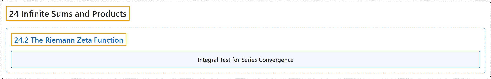

# 24.2 The Riemann Zeta Function

## Classification

## Glossary

| Term | Definition | 中文翻译 | Source |
|---|---|---|---|
| **24.2 The Riemann Zeta Function** 黎曼 ζ 函数 | "We define the **zeta function** (denoted $\zeta$) as **the sum of the infinite series $\zeta(s)=\sum_{n=1}^{\infty}\frac{1}{n^s}=1+\frac{1}{2^s}+\frac{1}{3^s}+\cdots$** as a function of $s$." | 我们把**无穷级数 $\zeta(s)=\sum_{n=1}^{\infty}\frac{1}{n^s}=1+\frac{1}{2^s}+\frac{1}{3^s}+\cdots$ 的和**作为 $s$ 的函数，定义为 **ζ 函数**（记作 $\zeta$）。 | [Crisman, 2024, Definition 24.2.1](https://math.gordon.edu/ntic/ntic/section-riemann-zeta.html#definition-zeta-function) |
| **Integral Test for Series Convergence** 级数收敛的积分判别法 | "Assume $f$ is a positive decreasing function going to zero as $x\to \infty$. Then **the series $\sum_{i=1}^n f(i)$ converges if and only if the integral $\int_1^{\infty}f(x)dx$ converges**." | 设 $f$ 是正的递减函数，且当 $x\to \infty$ 时趋于零。那么**级数 $\sum_{i=1}^n f(i)$ 收敛当且仅当积分 $\int_1^{\infty}f(x)dx$ 收敛**。 | [Crisman, 2024, Proposition 24.2.4](https://math.gordon.edu/ntic/ntic/section-riemann-zeta.html#prop-integral-test-series) |

## References

Crisman, K.-D. (2024). *Number theory: In context and interactive* (June 26, 2024 edition). Gordon College. Retrieved October 29, 2026, from <https://math.gordon.edu/ntic/ntic/>
