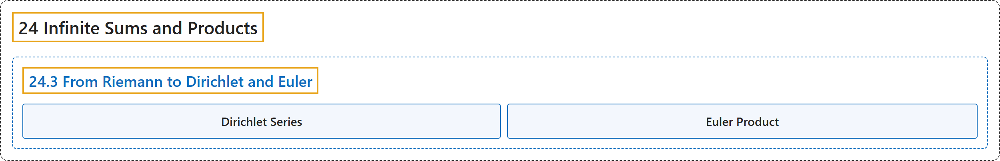

# 24.3 From Riemann to Dirichlet and Euler

## Classification

## Glossary

| Term | Definition | 中文翻译 | Source |
|---|---|---|---|
| **24.3 From Riemann to Dirichlet and Euler** 从黎曼到狄利克雷和欧拉 | (No definition) | （无定义） | [Crisman, 2024, section 24.3](https://math.gordon.edu/ntic/ntic/section-dirichlet-euler.html) |
| **Dirichlet Series** 狄利克雷级数 | "In general, for an arithmetic function $f(n)$, its **Dirichlet series** is **$F(s)=\sum_{n=1}^{\infty}\frac{f(n)}{n^s}$**." | 一般地，算术函数 $f(n)$ 的**狄利克雷级数**是 **$F(s)=\sum_{n=1}^{\infty}\frac{f(n)}{n^s}$**。 | [Crisman, 2024, Definition 24.3.1](https://math.gordon.edu/ntic/ntic/section-dirichlet-euler.html#definition-dirichlet-series) |
| **Euler Product** 欧拉乘积 | "In general, for an arithmetic function $f(n)$, its Dirichlet series is said to have an **Euler product** if **the series can be written as an infinite product** in the following manner: $\sum_{n=1}^{\infty}\frac{f(n)}{n^s}=\prod_p (\text{ a formula involving }f(p)\text{ and }p^s)$." | 一般地，若算术函数 $f(n)$ 的狄利克雷级数**能按下面的方式写成无穷乘积**，就说它有**欧拉乘积**：$\sum_{n=1}^{\infty}\frac{f(n)}{n^s}=\prod_p (\text{ a formula involving }f(p)\text{ and }p^s)$（右边是含 $f(p)$ 与 $p^s$ 的式子）。 | [Crisman, 2024, Definition 24.3.2](https://math.gordon.edu/ntic/ntic/section-dirichlet-euler.html#definition-euler-product) |

## References

Crisman, K.-D. (2024). *Number theory: In context and interactive* (June 26, 2024 edition). Gordon College. Retrieved October 29, 2026, from <https://math.gordon.edu/ntic/ntic/>
