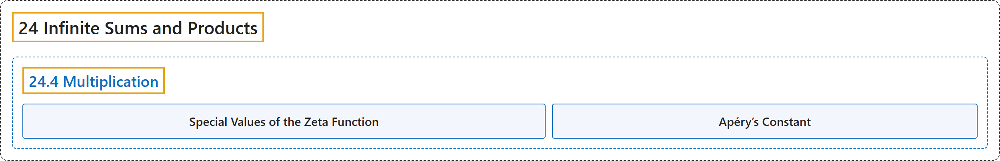

# 24.4 Multiplication

## Classification

## Glossary

| Term | Definition | 中文翻译 | Source |
|---|---|---|---|
| **24.4 Multiplication** 乘法 | (No definition) | （无定义） | [Crisman, 2024, section 24.4](https://math.gordon.edu/ntic/ntic/section-mult-series.html) |
| **Special Values of the Zeta Function** ζ 函数的特殊值 | "**Zeta has interesting values at integers**, not just for $s=2$. Euler calculated many even values of $\zeta$, which all look like **$\pi^{2n}$ times a rational number**" | **ζ 函数在整数处有有趣的值**，不只是 $s=2$。欧拉计算了许多偶数处的 $\zeta$ 值，它们都形如 **$\pi^{2n}$ 乘以一个有理数** | [Crisman, 2024, Remark 24.4.1](https://math.gordon.edu/ntic/ntic/section-mult-series.html#remark-zeta-values) |
| **Apéry’s Constant** 阿佩里常数 | "However, it was only in 1978 that **$\zeta(3)$** was shown to be *ir*rational. It was then named **Apéry’s constant** after the man who proved this, Roger Apéry." | 然而直到 1978 年，**$\zeta(3)$** 才被证明是*无*理数。于是它以证明者罗歇阿佩里的名字命名为**阿佩里常数**。 | [Crisman, 2024, Remark 24.4.1](https://math.gordon.edu/ntic/ntic/section-mult-series.html#remark-zeta-values) |

## References

Crisman, K.-D. (2024). *Number theory: In context and interactive* (June 26, 2024 edition). Gordon College. Retrieved October 29, 2026, from <https://math.gordon.edu/ntic/ntic/>
