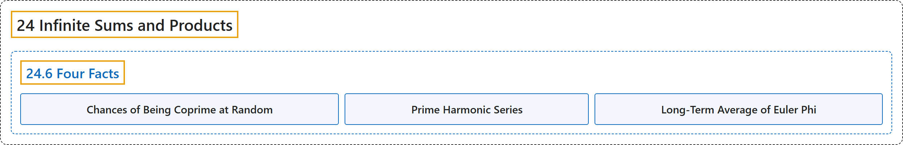

# 24.6 Four Facts

## Classification

## Glossary

| Term | Definition | 中文翻译 | Source |
|---|---|---|---|
| **24.6 Four Facts** 四个事实 | (No definition) | （无定义） | [Crisman, 2024, section 24.6](https://math.gordon.edu/ntic/ntic/section-four-facts.html) |
| **Chances of Being Coprime at Random** 随机整数互素的概率 | "This implies that **a random pair of integers, selected from a large enough bound, will be relatively prime about 61% of the time**." | 这意味着，**在足够大的范围内随机选取的一对整数，大约有 61% 的情况互素**。 | [Crisman, 2024, subsection 24.6.1](https://math.gordon.edu/ntic/ntic/section-four-facts.html#subsection-random-integer-lattice-9) |
| **Prime Harmonic Series** 素数调和级数 | "Let $p_n$ be the $n$th prime. Then the following series, which we call the **prime harmonic series**, diverges: **$\sum_{n=1}^{\infty}\frac{1}{p_n}$**" | 设 $p_n$ 是第 $n$ 个素数。那么下面这个称为**素数调和级数**的级数发散：**$\sum_{n=1}^{\infty}\frac{1}{p_n}$** | [Crisman, 2024, Proposition 24.6.4](https://math.gordon.edu/ntic/ntic/section-four-facts.html#prop-prime-harmonic) |
| **Long-Term Average of Euler Phi** 欧拉 φ 函数的长期平均 | "The long-term average value of $\phi$ is given by **$\lim_{n\to\infty}\frac{\frac{1}{n}\sum_{k=1}^n \phi(k)}{\frac{3}{\pi^2}n}=1$**" | $\phi$ 的长期平均值由下式给出：**$\lim_{n\to\infty}\frac{\frac{1}{n}\sum_{k=1}^n \phi(k)}{\frac{3}{\pi^2}n}=1$** | [Crisman, 2024, Proposition 24.6.7](https://math.gordon.edu/ntic/ntic/section-four-facts.html#prop-average-euler-phi) |

## References

Crisman, K.-D. (2024). *Number theory: In context and interactive* (June 26, 2024 edition). Gordon College. Retrieved October 29, 2026, from <https://math.gordon.edu/ntic/ntic/>
