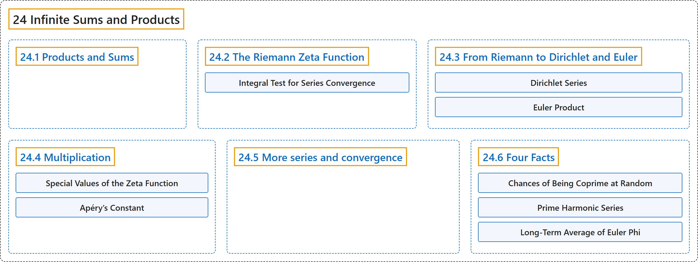

# 24 Infinite Sums and Products

## Classification

## Glossary

| Term | Definition | 中文翻译 | Source |
|---|---|---|---|
| **24 Infinite Sums and Products** 无穷和与无穷积 | (No definition) | （无定义） | [Crisman, 2024, chapter 24](https://math.gordon.edu/ntic/ntic/chapter-infinite-sums.html) |
| **[24.1 Products and Sums](24-1-products-and-sums.md)** 积与和 | (No definition) | （无定义） | [Crisman, 2024, section 24.1](https://math.gordon.edu/ntic/ntic/section-prod-sum.html) |
| **[24.2 The Riemann Zeta Function](24-2-the-riemann-zeta-function.md)** 黎曼 ζ 函数 | (No definition) | （无定义） | [Crisman, 2024, section 24.2](https://math.gordon.edu/ntic/ntic/section-riemann-zeta.html) |
| **[24.3 From Riemann to Dirichlet and Euler](24-3-from-riemann-to-dirichlet-and-euler.md)** 从黎曼到狄利克雷和欧拉 | (No definition) | （无定义） | [Crisman, 2024, section 24.3](https://math.gordon.edu/ntic/ntic/section-dirichlet-euler.html) |
| **[24.4 Multiplication](24-4-multiplication.md)** 乘法 | (No definition) | （无定义） | [Crisman, 2024, section 24.4](https://math.gordon.edu/ntic/ntic/section-mult-series.html) |
| **[24.5 More series and convergence](24-5-more-series-and-convergence.md)** 更多级数与收敛 | (No definition) | （无定义） | [Crisman, 2024, section 24.5](https://math.gordon.edu/ntic/ntic/section-inverse-series.html) |
| **[24.6 Four Facts](24-6-four-facts.md)** 四个事实 | (No definition) | （无定义） | [Crisman, 2024, section 24.6](https://math.gordon.edu/ntic/ntic/section-four-facts.html) |

## References

Crisman, K.-D. (2024). *Number theory: In context and interactive* (June 26, 2024 edition). Gordon College. Retrieved October 29, 2026, from <https://math.gordon.edu/ntic/ntic/>
