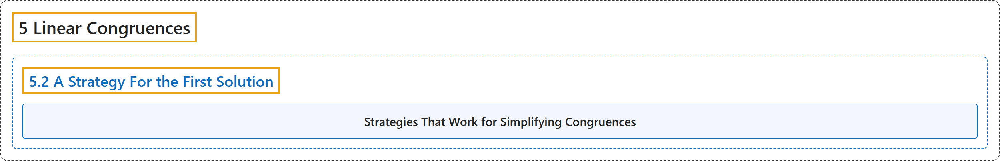

# 5.2 A Strategy For the First Solution

## Classification

## Glossary

| Term | Definition | 中文翻译 | Source |
|---|---|---|---|
| **5.2 A Strategy For the First Solution** 求第一个解的策略 | (No definition) | （无定义） | [Crisman, 2024, section 5.2](https://math.gordon.edu/ntic/ntic/section-strategy-lin-cong.html) |
| **Strategies That Work for Simplifying Congruences** 化简同余方程的有效策略 | "We can do two main types of simplification. First, there are **two types of cancellation**. **If $a$, $b$, and $n$ all are divisible by a common divisor, we can cancel that divisor out** (keeping in mind that we still will need our final solution to be modulo $n$). **If $a$ and $b$ share a common divisor which is coprime to the modulus, we can cancel that divisor from $a,b$ (only).** See Propositions 5.2.6 and 5.2.7 for precise statements and proofs. Secondly, there are **two counterintuitive operations** that may lead to a simpler congruence (using least nonnegative residues). **We could *multiply* $a$ and $b$ by something coprime to $n$.** If, after reducing modulo $n$, that makes $a$ or $b$ smaller, then that was a good idea! **We can *add* some multiple of $n$ to $b$.** Again, if that happens to make $a$ and (the new) $b$ share a factor, then it was a good idea!" | 我们可以做两大类化简。第一类是**两种约去**。**若 $a$、$b$ 和 $n$ 都能被一个公因数整除，就可以把这个因数约去**（记住最终的解仍要模 $n$）。**若 $a$ 与 $b$ 有一个与模互素的公因数，就可以（只）从 $a,b$ 中约去这个因数**。准确的陈述和证明见命题 5.2.6 和 5.2.7。第二类是**两种反直觉的操作**，它们可能得到更简单的同余方程（用最小非负剩余）。**我们可以把 $a$ 和 $b$ *乘上*某个与 $n$ 互素的数**。如果模 $n$ 约化后这使 $a$ 或 $b$ 变小了，那就是个好主意！**我们可以给 $b$ *加上* $n$ 的某个倍数**。同样，如果这恰好使 $a$ 与（新的）$b$ 有公因子，那就是个好主意！ | [Crisman, 2024, Fact 5.2.1](https://math.gordon.edu/ntic/ntic/section-strategy-lin-cong.html#fact-strategies-lin-cong-simp) |

## References

Crisman, K.-D. (2024). *Number theory: In context and interactive* (June 26, 2024 edition). Gordon College. Retrieved October 29, 2026, from <https://math.gordon.edu/ntic/ntic/>
