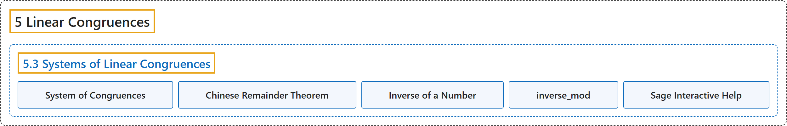

# 5.3 Systems of Linear Congruences

## Classification

## Glossary

| Term | Definition | 中文翻译 | Source |
|---|---|---|---|
| **5.3 Systems of Linear Congruences** 线性同余方程组 | (No definition) | （无定义） | [Crisman, 2024, section 5.3](https://math.gordon.edu/ntic/ntic/section-systems-lin-cong.html) |
| **System of Congruences** 同余方程组 | "Consider a *general* **system of $k$ (linear) congruences**: $x\equiv a_1$ (mod $n_1$) $x\equiv a_2$ (mod $n_2$) $\ldots$ $x\equiv a_k$ (mod $n_k$)" | 考虑*一般*的**由 $k$ 个（线性）同余方程组成的方程组**：$x\equiv a_1$ (mod $n_1$) $x\equiv a_2$ (mod $n_2$) $\ldots$ $x\equiv a_k$ (mod $n_k$) | [Crisman, 2024, Theorem 5.3.2](https://math.gordon.edu/ntic/ntic/section-systems-lin-cong.html#theorem-crt) |
| **Chinese Remainder Theorem** 中国剩余定理 | "Consider a *general* system of $k$ (linear) congruences: $x\equiv a_1$ (mod $n_1$) $x\equiv a_2$ (mod $n_2$) $\ldots$ $x\equiv a_k$ (mod $n_k$) **where all the $n_i$ are mutually coprime**. In this case, **we have an *algorithm* for solving the system**." | 考虑由 $k$ 个（线性）同余方程组成的*一般*方程组：$x\equiv a_1$ (mod $n_1$) $x\equiv a_2$ (mod $n_2$) $\ldots$ $x\equiv a_k$ (mod $n_k$) **其中所有 $n_i$ 两两互素**。这时**我们有求解这个方程组的*算法***。 | [Crisman, 2024, Theorem 5.3.2](https://math.gordon.edu/ntic/ntic/section-systems-lin-cong.html#theorem-crt) |
| **Inverse of a Number** 数的逆 | "The **inverse of a number** $a$ modulo $n$ is **the least nonnegative solution of the congruence $ax\equiv 1\text{ (mod }n)$**. It is sometimes notated $a^{-1}$." | 数 $a$ 模 $n$ 的**逆**是**同余方程 $ax\equiv 1\text{ (mod }n)$ 的最小非负解**。有时记作 $a^{-1}$。 | [Crisman, 2024, Definition 5.3.4](https://math.gordon.edu/ntic/ntic/section-systems-lin-cong.html#definition-inverse-number) |
| **inverse_mod** inverse_mod | "The following Sage command computes the “**inverse of 26 modulo 31**”." | 下面的 Sage 命令计算“**26 模 31 的逆**”。 | [Crisman, 2024, subsection 5.3.2](https://math.gordon.edu/ntic/ntic/section-systems-lin-cong.html#subsection-inverse-number-8) |
| **Sage Interactive Help** Sage 交互式帮助 | "You can look for **more information on Sage commands** by **using question marks**. Try `inverse_mod?` and `inverse_mod??` in a notebook, command line interface, or CoCalc." | 你可以**用问号**来查找**关于 Sage 命令的更多信息**。在笔记本、命令行界面或 CoCalc 中试试 `inverse_mod?` 和 `inverse_mod??`。 | [Crisman, 2024, Sage note 5.3.8](https://math.gordon.edu/ntic/ntic/section-systems-lin-cong.html#sagenote-interactive-help) |

## References

Crisman, K.-D. (2024). *Number theory: In context and interactive* (June 26, 2024 edition). Gordon College. Retrieved October 29, 2026, from <https://math.gordon.edu/ntic/ntic/>
