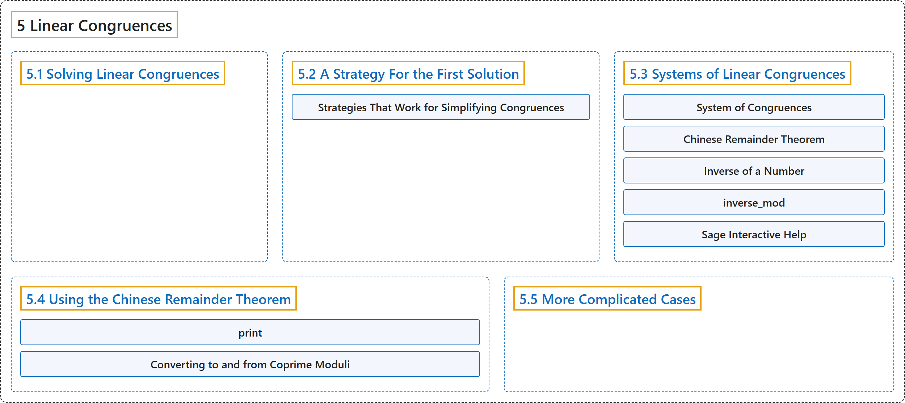

# 5 Linear Congruences

## Classification

## Glossary

| Term | Definition | 中文翻译 | Source |
|---|---|---|---|
| **5 Linear Congruences** 线性同余方程 | "So in this chapter, we will stay focused on the simplest case, of **the analogue to linear equations**, known as **linear congruences** (of one variable)." | 所以本章我们只关注最简单的情形，即**线性方程的类比**，称为（一元）**线性同余方程**。 | [Crisman, 2024, chapter 5](https://math.gordon.edu/ntic/ntic/chapter-linear-congruences.html#chapter-linear-congruences-2-5) |
| **[5.1 Solving Linear Congruences](5-1-solving-linear-congruences.md)** 解线性同余方程 | (No definition) | （无定义） | [Crisman, 2024, section 5.1](https://math.gordon.edu/ntic/ntic/section-solve-lin-cong.html) |
| **[5.2 A Strategy For the First Solution](5-2-a-strategy-for-the-first-solution.md)** 求第一个解的策略 | (No definition) | （无定义） | [Crisman, 2024, section 5.2](https://math.gordon.edu/ntic/ntic/section-strategy-lin-cong.html) |
| **[5.3 Systems of Linear Congruences](5-3-systems-of-linear-congruences.md)** 线性同余方程组 | (No definition) | （无定义） | [Crisman, 2024, section 5.3](https://math.gordon.edu/ntic/ntic/section-systems-lin-cong.html) |
| **[5.4 Using the Chinese Remainder Theorem](5-4-using-the-chinese-remainder-theorem.md)** 使用中国剩余定理 | (No definition) | （无定义） | [Crisman, 2024, section 5.4](https://math.gordon.edu/ntic/ntic/section-using-crt.html) |
| **[5.5 More Complicated Cases](5-5-more-complicated-cases.md)** 更复杂的情形 | (No definition) | （无定义） | [Crisman, 2024, section 5.5](https://math.gordon.edu/ntic/ntic/section-beyond-crt.html) |

## References

Crisman, K.-D. (2024). *Number theory: In context and interactive* (June 26, 2024 edition). Gordon College. Retrieved October 29, 2026, from <https://math.gordon.edu/ntic/ntic/>
