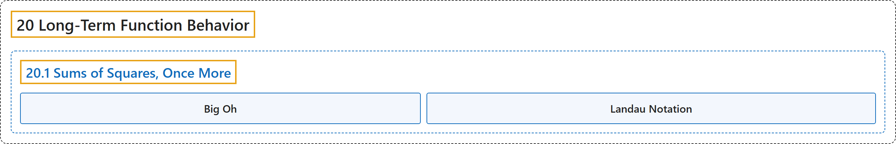

# 20.1 Sums of Squares, Once More

## Classification

## Glossary

| Term | Definition | 中文翻译 | Source |
|---|---|---|---|
| **20.1 Sums of Squares, Once More** 再谈平方和 | (No definition) | （无定义） | [Crisman, 2024, section 20.1](https://math.gordon.edu/ntic/ntic/section-sum-sq-bounds.html) |
| **Big Oh** 大 O | "We say that $f(x)$ is $O(g(x))$ (“eff of eks is Big Oh of gee of eks”) if **there is some positive constant $C$ and some positive number $x_0$ for which $\vert f(x)\vert\leq Cg(x)\text{ for all }x>x_0$**. This is known as **Landau notation**." | 若**存在某个正常数 $C$ 和某个正数 $x_0$，使 $\vert f(x)\vert\leq Cg(x)\text{ for all }x>x_0$**（对所有 $x>x_0$ 成立），就说 $f(x)$ 是 $O(g(x))$（读作“f(x) 是 g(x) 的大 O”）。这称为**朗道记号**。 | [Crisman, 2024, Definition 20.1.2](https://math.gordon.edu/ntic/ntic/section-sum-sq-bounds.html#definition-landau) |
| **Landau Notation** 朗道记号 | "We say that $f(x)$ is $O(g(x))$ (“eff of eks is Big Oh of gee of eks”) if **there is some positive constant $C$ and some positive number $x_0$ for which $\vert f(x)\vert\leq Cg(x)\text{ for all }x>x_0$**. This is known as **Landau notation**." | 若**存在某个正常数 $C$ 和某个正数 $x_0$，使 $\vert f(x)\vert\leq Cg(x)\text{ for all }x>x_0$**（对所有 $x>x_0$ 成立），就说 $f(x)$ 是 $O(g(x))$（读作“f(x) 是 g(x) 的大 O”）。这称为**朗道记号**。 | [Crisman, 2024, Definition 20.1.2](https://math.gordon.edu/ntic/ntic/section-sum-sq-bounds.html#definition-landau) |

## References

Crisman, K.-D. (2024). *Number theory: In context and interactive* (June 26, 2024 edition). Gordon College. Retrieved October 29, 2026, from <https://math.gordon.edu/ntic/ntic/>
