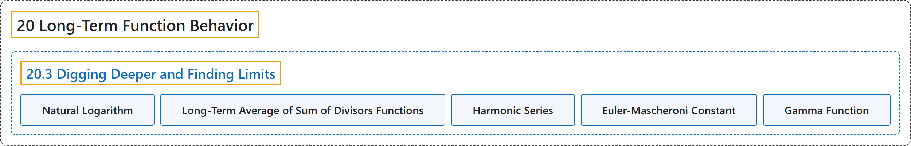

# 20.3 Digging Deeper and Finding Limits

## Classification

## Glossary

| Term | Definition | 中文翻译 | Source |
|---|---|---|---|
| **20.3 Digging Deeper and Finding Limits** 深入挖掘并求极限 | (No definition) | （无定义） | [Crisman, 2024, section 20.3](https://math.gordon.edu/ntic/ntic/section-tau-limits.html) |
| **Natural Logarithm** 自然对数 | "Throughout this text we use $\log(n)$ to mean **the natural logarithm with base $e$**." | 本书中 $\log(n)$ 一律表示**以 $e$ 为底的自然对数**。 | [Crisman, 2024, Definition 20.3.3](https://math.gordon.edu/ntic/ntic/section-tau-limits.html#definition-log) |
| **Long-Term Average of Sum of Divisors Functions** 因数和函数的长期平均 | "**The error $\sum_{k=1}^n \tau(k)-n\log(n)$ is a positive real number less than $n$ minus a (different positive real) number less than $n$.** So the error is *certainly* $O(n)$ (less than some multiple of $n$ as $n$ gets huge)." | **误差 $\sum_{k=1}^n \tau(k)-n\log(n)$ 是一个小于 $n$ 的正实数减去另一个小于 $n$ 的（不同的正实）数**。所以误差*肯定*是 $O(n)$（当 $n$ 很大时小于 $n$ 的某个倍数）。 | [Crisman, 2024, Fact 20.3.5](https://math.gordon.edu/ntic/ntic/section-tau-limits.html#fact-average-tau-error) |
| **Harmonic Series** 调和级数 | "This number is very important! First of all, it clearly is related to **the archetypal *divergent* series from calculus**, the **harmonic series** $\sum_{k=1}^{\infty} \frac{1}{k}$" | 这个数非常重要！首先，它显然与**微积分中典型的*发散*级数**，即**调和级数** $\sum_{k=1}^{\infty} \frac{1}{k}$ 有关 | [Crisman, 2024, subsection 20.3.3](https://math.gordon.edu/ntic/ntic/section-tau-limits.html#subsection-tau-average-end-6) |
| **Euler-Mascheroni Constant** 欧拉-马斯克罗尼常数 | "The number $\gamma$, or the **Euler-Mascheroni constant**, is defined by **$\gamma=\lim_{m\to\infty}\left(\sum_{k=1}^{m-1} \frac{1}{k}-\log(m)\right)$**" | 数 $\gamma$，即**欧拉-马斯克罗尼常数**，定义为 **$\gamma=\lim_{m\to\infty}\left(\sum_{k=1}^{m-1} \frac{1}{k}-\log(m)\right)$** | [Crisman, 2024, Definition 20.3.10](https://math.gordon.edu/ntic/ntic/section-tau-limits.html#definition-euler-gamma) |
| **Gamma Function** 伽马函数 | "Among other crazy properties, $-\gamma$ is the derivative (at $x=1$) of **a generalized factorial function**, called **Gamma ($\Gamma$)**." | 在其他一些疯狂的性质中，$-\gamma$ 是**一种推广的阶乘函数**（称为 **Gamma，即 $\Gamma$**）在 $x=1$ 处的导数。 | [Crisman, 2024, Remark 20.3.11](https://math.gordon.edu/ntic/ntic/section-tau-limits.html#remark-gamma-crazy) |

## References

Crisman, K.-D. (2024). *Number theory: In context and interactive* (June 26, 2024 edition). Gordon College. Retrieved October 29, 2026, from <https://math.gordon.edu/ntic/ntic/>
