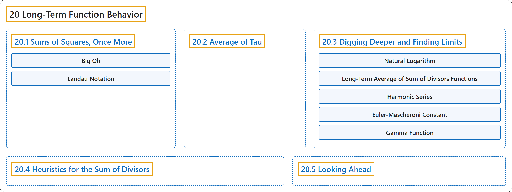

# 20 Long-Term Function Behavior

## Classification

## Glossary

| Term | Definition | 中文翻译 | Source |
|---|---|---|---|
| **20 Long-Term Function Behavior** 函数的长期行为 | (No definition) | （无定义） | [Crisman, 2024, chapter 20](https://math.gordon.edu/ntic/ntic/chapter-function-averages.html) |
| **[20.1 Sums of Squares, Once More](20-1-sums-of-squares-once-more.md)** 再谈平方和 | (No definition) | （无定义） | [Crisman, 2024, section 20.1](https://math.gordon.edu/ntic/ntic/section-sum-sq-bounds.html) |
| **[20.2 Average of Tau](20-2-average-of-tau.md)** τ 的平均 | (No definition) | （无定义） | [Crisman, 2024, section 20.2](https://math.gordon.edu/ntic/ntic/section-tau-average.html) |
| **[20.3 Digging Deeper and Finding Limits](20-3-digging-deeper-and-finding-limits.md)** 深入挖掘并求极限 | (No definition) | （无定义） | [Crisman, 2024, section 20.3](https://math.gordon.edu/ntic/ntic/section-tau-limits.html) |
| **[20.4 Heuristics for the Sum of Divisors](20-4-heuristics-for-the-sum-of-divisors.md)** 因数和的启发式分析 | (No definition) | （无定义） | [Crisman, 2024, section 20.4](https://math.gordon.edu/ntic/ntic/section-sigma-average.html) |
| **[20.5 Looking Ahead](20-5-looking-ahead.md)** 展望 | (No definition) | （无定义） | [Crisman, 2024, section 20.5](https://math.gordon.edu/ntic/ntic/section-averages-ahead.html) |

## References

Crisman, K.-D. (2024). *Number theory: In context and interactive* (June 26, 2024 edition). Gordon College. Retrieved October 29, 2026, from <https://math.gordon.edu/ntic/ntic/>
