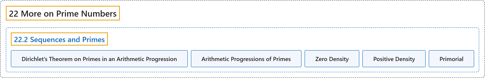

# 22.2 Sequences and Primes

## Classification

## Glossary

| Term | Definition | 中文翻译 | Source |
|---|---|---|---|
| **22.2 Sequences and Primes** 数列与素数 | (No definition) | （无定义） | [Crisman, 2024, section 22.2](https://math.gordon.edu/ntic/ntic/section-primes-seqs.html) |
| **Dirichlet’s Theorem on Primes in an Arithmetic Progression** 狄利克雷算术级数素数定理 | "If $\gcd(a,b)=1$, then **there are infinitely many primes of the form $ax+b$** for $x$ an integer." | 若 $\gcd(a,b)=1$，则对整数 $x$，**形如 $ax+b$ 的素数有无穷多个**。 | [Crisman, 2024, Theorem 22.2.1](https://math.gordon.edu/ntic/ntic/section-primes-seqs.html#theorem-dirichlet-primes) |
| **Arithmetic Progressions of Primes** 素数中的算术级数 | "Once again, the answer is yes! This is a theorem of Ben Green and Terry Tao, which was a significant piece of Tao’s 2006 Fields Medal (though he probably would have won it even without this, remarkable as it may seem)." | 答案又一次是肯定的！这是本格林和陶哲轩的一个定理，是陶哲轩 2006 年菲尔兹奖的重要组成部分（尽管说来惊人，就算没有它，他大概也会获奖）。 | [Crisman, 2024, subsection 22.2.2](https://math.gordon.edu/ntic/ntic/section-primes-seqs.html#subsection-sequences-primes-10) |
| **Zero Density** 零密度 | "There is a technical way to measure this: $\lim_{n\to\infty}\frac{\pi(n)}{n}=0$. This follows from Chebyshev’s estimate in Theorem 21.3.6, and is called having **zero density.**" | 有一种专门的方式来衡量这一点：$\lim_{n\to\infty}\frac{\pi(n)}{n}=0$。这由定理 21.3.6 中切比雪夫的估计得出，称为具有**零密度**。 | [Crisman, 2024, subsection 22.2.2](https://math.gordon.edu/ntic/ntic/section-primes-seqs.html#subsection-sequences-primes-11) |
| **Positive Density** 正密度 | "Now, if you have a collection of numbers which has **positive density** (i.e. **the limit is positive, not zero**), it is a theorem from 1974 (by Endre Szemerédi) that you can get arithmetic progressions of arbitrary length in such sets." | 如果一个数集具有**正密度**（即**极限为正而非零**），那么由 1974 年的一个定理（Endre Szemerédi 证明），这样的集合中可以找到任意长的算术级数。 | [Crisman, 2024, subsection 22.2.2](https://math.gordon.edu/ntic/ntic/section-primes-seqs.html#subsection-sequences-primes-11) |
| **Primorial** 素数阶乘 | "For a prime $p$, we call the **primorial** the number **$p\#=\prod_{q\leq p,\; q\text{ prime}} q$**" | 对素数 $p$，我们把数 **$p\#=\prod_{q\leq p,\; q\text{ prime}} q$** 称为**素数阶乘** | [Crisman, 2024, Definition 22.2.7](https://math.gordon.edu/ntic/ntic/section-primes-seqs.html#definition-primorial) |

## References

Crisman, K.-D. (2024). *Number theory: In context and interactive* (June 26, 2024 edition). Gordon College. Retrieved October 29, 2026, from <https://math.gordon.edu/ntic/ntic/>
