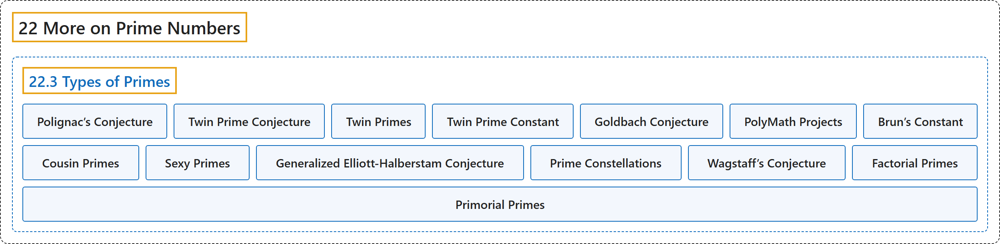

# 22.3 Types of Primes

## Classification

## Glossary

| Term | Definition | 中文翻译 | Source |
|---|---|---|---|
| **22.3 Types of Primes** 素数的类型 | (No definition) | （无定义） | [Crisman, 2024, section 22.3](https://math.gordon.edu/ntic/ntic/section-prime-types.html) |
| **Polignac’s Conjecture** 波利尼亚克猜想 | "**Every even number is the difference between *consecutive* primes in infinitely many ways.**" | **每个偶数都能以无穷多种方式写成*相邻*素数之差**。 | [Crisman, 2024, Conjecture 22.3.2](https://math.gordon.edu/ntic/ntic/section-prime-types.html#conjecture-polignac) |
| **Twin Prime Conjecture** 孪生素数猜想 | "**There are infinitely many consecutive odd prime numbers.**" | **存在无穷多对相邻的奇素数**。 | [Crisman, 2024, Conjecture 22.3.3](https://math.gordon.edu/ntic/ntic/section-prime-types.html#conjecture-twin-prime) |
| **Twin Primes** 孪生素数 | "Pairs of primes $p$ and $q$ such that **$p+2=q$** are called **twin primes**." | 满足 **$p+2=q$** 的素数对 $p$ 和 $q$ 称为**孪生素数**。 | [Crisman, 2024, Definition 22.3.4](https://math.gordon.edu/ntic/ntic/section-prime-types.html#definition-twin-prime) |
| **Twin Prime Constant** 孪生素数常数 | "The constant part of this formula is finite, and known as the **twin prime constant**: **$C_2=2\prod_{p>2}\left( 1-\frac{1}{p-1}^2\right)$**." | 这个公式中的常数部分是有限的，称为**孪生素数常数**：**$C_2=2\prod_{p>2}\left( 1-\frac{1}{p-1}^2\right)$**。 | [Crisman, 2024, Remark 22.3.6](https://math.gordon.edu/ntic/ntic/section-prime-types.html#remark-twin-prime-constant) |
| **Goldbach Conjecture** 哥德巴赫猜想 | "**Any even number can be written in at least *one* way as a sum of two primes.**" | **任何偶数都至少能以*一种*方式写成两个素数之和**。 | [Crisman, 2024, Conjecture 22.3.8](https://math.gordon.edu/ntic/ntic/section-prime-types.html#conjecture-goldbach) |
| **PolyMath Projects** PolyMath 项目 | "This was a huge improvement over previous results, and **further work of an unusually collaborative nature** have now reduced this bound to $N\leq 246$, but the effort has not continued progress." | 这是对以往结果的巨大改进，而**一种异常协作式的后续工作**已把这个界降到 $N\leq 246$，但这项努力没有再取得进展。 | [Crisman, 2024, Historical remark 22.3.10](https://math.gordon.edu/ntic/ntic/section-prime-types.html#remark-twin-prime-update) |
| **Brun’s Constant** 布伦常数 | "Although there may really be infinitely many pairs, **the sum of their reciprocals** $\sum_{p,p+2 \text{ both prime}} \frac{1}{p}+\frac{1}{p+2}$ is still a finite constant. At the very least means twin primes must be pretty rare. This (possibly infinite) sum is called **Brun’s constant**." | 尽管这样的数对可能确实有无穷多，**它们的倒数之和** $\sum_{p,p+2 \text{ both prime}} \frac{1}{p}+\frac{1}{p+2}$ 仍是一个有限常数。这至少意味着孪生素数一定相当稀少。这个（项数可能无穷的）和称为**布伦常数**。 | [Crisman, 2024, subsection 22.3.2](https://math.gordon.edu/ntic/ntic/section-prime-types.html#subsection-more-twin-primes-16) |
| **Cousin Primes** 表兄弟素数 | "In the quest toward Polignac’s Conjecture, researchers have dubbed primes (not necessarily consecutive) **with spacing $N=4$** **cousin primes** and those **$N=6$ apart** **sexy primes**." | 在追寻波利尼亚克猜想的过程中，研究者把**间距为 $N=4$** 的素数（不一定相邻）称为**表兄弟素数**，把**相距 $N=6$** 的称为**六素数**。 | [Crisman, 2024, subsection 22.3.3](https://math.gordon.edu/ntic/ntic/section-prime-types.html#subsection-other-primes-2) |
| **Sexy Primes** 六素数 | "In the quest toward Polignac’s Conjecture, researchers have dubbed primes (not necessarily consecutive) **with spacing $N=4$** **cousin primes** and those **$N=6$ apart** **sexy primes**." | 在追寻波利尼亚克猜想的过程中，研究者把**间距为 $N=4$** 的素数（不一定相邻）称为**表兄弟素数**，把**相距 $N=6$** 的称为**六素数**。 | [Crisman, 2024, subsection 22.3.3](https://math.gordon.edu/ntic/ntic/section-prime-types.html#subsection-other-primes-2) |
| **Generalized Elliott-Halberstam Conjecture** 广义 Elliott-Halberstam 猜想 | "In another result of similar vintage to Zhang’s (and also collaborative like its refinement), we know (conditional upon the so-called “generalized Elliott-Halberstam conjecture”, which is closely related to our investigations in Subsection 22.2.2) that **at least one of the classes of twin, cousin, or sexy primes is infinite**" | 在与张益唐的结果同时期的另一个结果中（它也像那个改进一样是协作完成的），我们知道（以所谓“广义 Elliott-Halberstam 猜想”为条件，它与我们在 22.2.2 小节中的研究密切相关）**孪生、表兄弟或六素数这几类中至少有一类是无穷的** | [Crisman, 2024, subsection 22.3.3](https://math.gordon.edu/ntic/ntic/section-prime-types.html#subsection-other-primes-2) |
| **Prime Constellations** 素数星座 | "This is a very special case of exploring something called **prime constellations**; see Exercise 22.4.13." | 这是探索所谓**素数星座**的一个非常特殊的情形；见习题 22.4.13。 | [Crisman, 2024, subsection 22.3.3](https://math.gordon.edu/ntic/ntic/section-prime-types.html#subsection-other-primes-2) |
| **Wagstaff’s Conjecture** 瓦格斯塔夫猜想 | "Using similar ideas, one can get a heuristic that **Mersenne primes are distributed as $e^{\gamma}\log(\log(x))/\log(2)$**. This is known as **Wagstaff’s conjecture**." | 用类似的想法，可以得到一个启发式估计：**梅森素数的分布为 $e^{\gamma}\log(\log(x))/\log(2)$**。这称为**瓦格斯塔夫猜想**。 | [Crisman, 2024, subsection 22.3.3](https://math.gordon.edu/ntic/ntic/section-prime-types.html#subsection-other-primes-3-2-2) |
| **Factorial Primes** 阶乘素数 | "Bizarrely, one can use the same idea to get a heuristic for **factorial primes**. These are **primes of the form $n! \pm 1$**, like 5, 7, 23, and 719." | 奇妙的是，可以用同样的想法得到关于**阶乘素数**的启发式估计。它们是**形如 $n! \pm 1$ 的素数**，如 5、7、23 和 719。 | [Crisman, 2024, subsection 22.3.3](https://math.gordon.edu/ntic/ntic/section-prime-types.html#subsection-other-primes-3-2-3) |
| **Primorial Primes** 素数阶乘素数 | "These rules of thumb even seem to apply to the so-called **primorial primes** – **primes of the form $p\#\pm 1$**, like 3, 5, 7, 29, 31, 211, etc." | 这些经验法则似乎甚至适用于所谓的**素数阶乘素数**，即**形如 $p\#\pm 1$ 的素数**，如 3、5、7、29、31、211 等。 | [Crisman, 2024, subsection 22.3.3](https://math.gordon.edu/ntic/ntic/section-prime-types.html#subsection-other-primes-3-2-4) |

## References

Crisman, K.-D. (2024). *Number theory: In context and interactive* (June 26, 2024 edition). Gordon College. Retrieved October 29, 2026, from <https://math.gordon.edu/ntic/ntic/>
