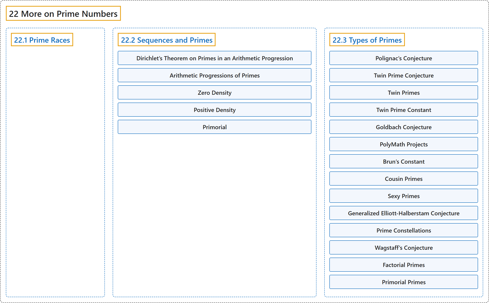

# 22 More on Prime Numbers

## Classification

## Glossary

| Term | Definition | 中文翻译 | Source |
|---|---|---|---|
| **22 More on Prime Numbers** 素数续论 | (No definition) | （无定义） | [Crisman, 2024, chapter 22](https://math.gordon.edu/ntic/ntic/chapter-more-primes.html) |
| **[22.1 Prime Races](22-1-prime-races.md)** 素数竞赛 | (No definition) | （无定义） | [Crisman, 2024, section 22.1](https://math.gordon.edu/ntic/ntic/section-prime-races.html) |
| **[22.2 Sequences and Primes](22-2-sequences-and-primes.md)** 数列与素数 | (No definition) | （无定义） | [Crisman, 2024, section 22.2](https://math.gordon.edu/ntic/ntic/section-primes-seqs.html) |
| **[22.3 Types of Primes](22-3-types-of-primes.md)** 素数的类型 | (No definition) | （无定义） | [Crisman, 2024, section 22.3](https://math.gordon.edu/ntic/ntic/section-prime-types.html) |

## References

Crisman, K.-D. (2024). *Number theory: In context and interactive* (June 26, 2024 edition). Gordon College. Retrieved October 29, 2026, from <https://math.gordon.edu/ntic/ntic/>
