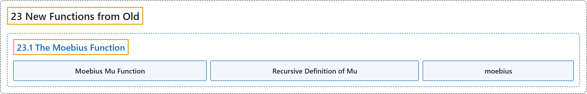

# 23.1 The Moebius Function

## Classification

## Glossary

| Term | Definition | 中文翻译 | Source |
|---|---|---|---|
| **23.1 The Moebius Function** 默比乌斯函数 | (No definition) | （无定义） | [Crisman, 2024, section 23.1](https://math.gordon.edu/ntic/ntic/section-moebius-mu.html) |
| **Moebius Mu Function** 默比乌斯 μ 函数 | "Let $N=2\cdot 3\cdot 5\cdots q$ be the product of the first few primes, up to $q$. Then we define $\mu(d)$ as follows: **$\prod_{p\mid N}\left(1-\frac{1}{p}\right)=\sum_{d\mid N}\frac{\mu(d)}{d}$**. The product is over *prime* factors of $N$ but the sum is over *all* factors of $N$." | 设 $N=2\cdot 3\cdot 5\cdots q$ 是前若干个素数（直到 $q$）之积。我们这样定义 $\mu(d)$：**$\prod_{p\mid N}\left(1-\frac{1}{p}\right)=\sum_{d\mid N}\frac{\mu(d)}{d}$**。乘积取遍 $N$ 的*素*因数，而求和取遍 $N$ 的*所有*因数。 | [Crisman, 2024, Definition 23.1.1](https://math.gordon.edu/ntic/ntic/section-moebius-mu.html#definition-moebius-mu) |
| **Recursive Definition of Mu** μ 的递归定义 | "We can define $\mu$ by setting **$\mu(1)=1$ and $\sum_{d\mid n}\mu(d)=0$**." | 可以这样定义 $\mu$：令 **$\mu(1)=1$，且 $\sum_{d\mid n}\mu(d)=0$**。 | [Crisman, 2024, Proposition 23.1.5](https://math.gordon.edu/ntic/ntic/section-moebius-mu.html#prop-recursive-moebius) |
| **moebius** moebius | "Remember, we can always **check calculations like this with our computational assistant**." | 记住，我们总可以**用计算助手核对这样的计算**。 | [Crisman, 2024, Sage note 23.1.6](https://math.gordon.edu/ntic/ntic/section-moebius-mu.html#sagenote-check-work-2) |

## References

Crisman, K.-D. (2024). *Number theory: In context and interactive* (June 26, 2024 edition). Gordon College. Retrieved October 29, 2026, from <https://math.gordon.edu/ntic/ntic/>
