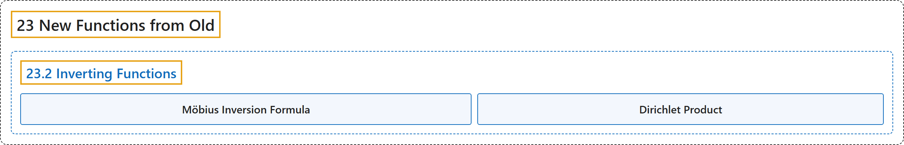

# 23.2 Inverting Functions

## Classification

## Glossary

| Term | Definition | 中文翻译 | Source |
|---|---|---|---|
| **23.2 Inverting Functions** 函数的反演 | (No definition) | （无定义） | [Crisman, 2024, section 23.2](https://math.gordon.edu/ntic/ntic/section-invert-funcs.html) |
| **Möbius Inversion Formula** 默比乌斯反演公式 | "If $f(n)=\sum_{d\mid n}g(d)$, then **$g(n)=\sum_{d\mid n}\mu(d)f\left(\frac{n}{d}\right)$**." | 若 $f(n)=\sum_{d\mid n}g(d)$，则 **$g(n)=\sum_{d\mid n}\mu(d)f\left(\frac{n}{d}\right)$**。 | [Crisman, 2024, Theorem 23.2.1](https://math.gordon.edu/ntic/ntic/section-invert-funcs.html#theorem-moebius-inversion) |
| **Dirichlet Product** 狄利克雷乘积 | "Let $f$ and $g$ be arithmetic functions. Then we define the new function $f\star g$, the **Dirichlet product**, via the formula **$(f\star g)(n)=\sum_{de=n}f(d)g(e)=\sum_{d\mid n}f(d)g\left(\frac{n}{d}\right)$**." | 设 $f$ 和 $g$ 是算术函数。我们用下式定义新函数 $f\star g$，即**狄利克雷乘积**：**$(f\star g)(n)=\sum_{de=n}f(d)g(e)=\sum_{d\mid n}f(d)g\left(\frac{n}{d}\right)$**。 | [Crisman, 2024, Definition 23.2.3](https://math.gordon.edu/ntic/ntic/section-invert-funcs.html#definition-dirichlet-product) |

## References

Crisman, K.-D. (2024). *Number theory: In context and interactive* (June 26, 2024 edition). Gordon College. Retrieved October 29, 2026, from <https://math.gordon.edu/ntic/ntic/>
