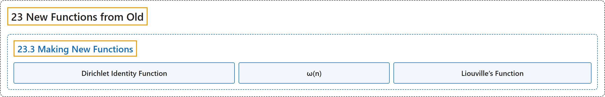

# 23.3 Making New Functions

## Classification

## Glossary

| Term | Definition | 中文翻译 | Source |
|---|---|---|---|
| **23.3 Making New Functions** 构造新函数 | (No definition) | （无定义） | [Crisman, 2024, section 23.3](https://math.gordon.edu/ntic/ntic/section-new-funcs.html) |
| **Dirichlet Identity Function** 狄利克雷单位函数 | "We define a new simple arithmetic function to go along with those from Definition 19.2.9. $u(n)=1$ for all $n$ $N(n)=n$ for all $n$ **$I(n)=\begin{cases}1& n=1\\0 & n>1\end{cases}$**" | 我们定义一个新的简单算术函数，与定义 19.2.9 中的那些配合使用。对所有 $n$，$u(n)=1$；对所有 $n$，$N(n)=n$；**$I(n)=\begin{cases}1& n=1\\0 & n>1\end{cases}$** | [Crisman, 2024, Definition 23.3.1](https://math.gordon.edu/ntic/ntic/section-new-funcs.html#definition-dirichlet-identity) |
| **ω(n)** ω(n) | "then we can give the name $\omega(n)=k$ to **the number of unique prime divisors of an integer**. (This is sometimes called $\nu(n)$ in the literature.)" | 那么可以把**一个整数的不同素因数的个数**记为 $\omega(n)=k$。（文献中有时记作 $\nu(n)$。） | [Crisman, 2024, Definition 23.3.3](https://math.gordon.edu/ntic/ntic/section-new-funcs.html#definition-omega-prime-divs) |
| **Liouville’s Function** 刘维尔函数 | "If $n=\prod_{i=1}^k p_i^{e_i}$, we summarize **the parity of the total powers of primes dividing a number** as $\lambda(n)=(-1)^{e_1+e_2+\cdots+e_k}$. This is called **Liouville’s function**." | 若 $n=\prod_{i=1}^k p_i^{e_i}$，我们把**整除一个数的素数的总次数的奇偶性**概括为 $\lambda(n)=(-1)^{e_1+e_2+\cdots+e_k}$。这称为**刘维尔函数**。 | [Crisman, 2024, Definition 23.3.4](https://math.gordon.edu/ntic/ntic/section-new-funcs.html#definition-liouville-fn) |

## References

Crisman, K.-D. (2024). *Number theory: In context and interactive* (June 26, 2024 edition). Gordon College. Retrieved October 29, 2026, from <https://math.gordon.edu/ntic/ntic/>
