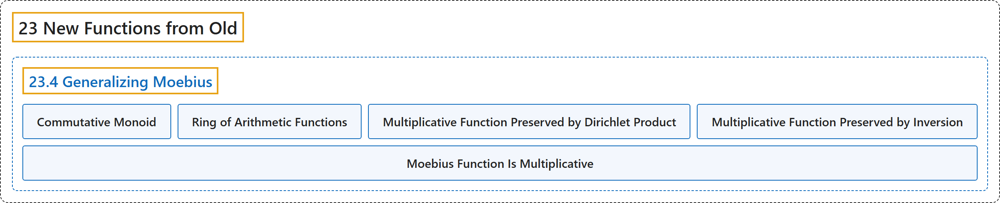

# 23.4 Generalizing Moebius

## Classification

## Glossary

| Term | Definition | 中文翻译 | Source |
|---|---|---|---|
| **23.4 Generalizing Moebius** 推广默比乌斯函数 | (No definition) | （无定义） | [Crisman, 2024, section 23.4](https://math.gordon.edu/ntic/ntic/section-gen-moebius.html) |
| **Commutative Monoid** 交换幺半群 | "A **commutative monoid** is **a set with multiplication (an operation) that has an identity, is associative and commutative**." | **交换幺半群**是**带有乘法（一种运算）的集合，该运算有单位元，满足结合律和交换律**。 | [Crisman, 2024, Definition 23.4.1](https://math.gordon.edu/ntic/ntic/section-gen-moebius.html#definition-comm-monoid) |
| **Ring of Arithmetic Functions** 算术函数环 | "For a higher-level but useful and readable account of the ***ring theory* of arithmetic functions** (including valuations and derivations), see [E.2.8, Chapters 3 and 4]." | 关于**算术函数的*环论***（包括赋值和导子）的更高层次但有用且易读的论述，见 [E.2.8, Chapters 3 and 4]。 | [Crisman, 2024, Remark 23.4.7](https://math.gordon.edu/ntic/ntic/section-gen-moebius.html#remark-ring-theory-arith-fns) |
| **Multiplicative Function Preserved by Dirichlet Product** 积性函数在狄利克雷乘积下保持 | "If $g$ and $h$ are multiplicative, then **$f=g\star h$ is also multiplicative**." | 若 $g$ 和 $h$ 是积性的，则 **$f=g\star h$ 也是积性的**。 | [Crisman, 2024, Proposition 23.4.10](https://math.gordon.edu/ntic/ntic/section-gen-moebius.html#prop-star-preserves-mult) |
| **Multiplicative Function Preserved by Inversion** 积性函数在求逆下保持 | "If $f$ is multiplicative and $f(1)\neq 0$, then **$f^{-1}$ is also multiplicative**." | 若 $f$ 是积性的且 $f(1)\neq 0$，则 **$f^{-1}$ 也是积性的**。 | [Crisman, 2024, Proposition 23.4.11](https://math.gordon.edu/ntic/ntic/section-gen-moebius.html#prop-inverse-preserves-mult) |
| **Moebius Function Is Multiplicative** 默比乌斯函数是积性的 | "**The function $\mu$ is multiplicative.**" | **函数 $\mu$ 是积性的**。 | [Crisman, 2024, Corollary 23.4.15](https://math.gordon.edu/ntic/ntic/section-gen-moebius.html#cor-moebius-multiplicative) |

## References

Crisman, K.-D. (2024). *Number theory: In context and interactive* (June 26, 2024 edition). Gordon College. Retrieved October 29, 2026, from <https://math.gordon.edu/ntic/ntic/>
