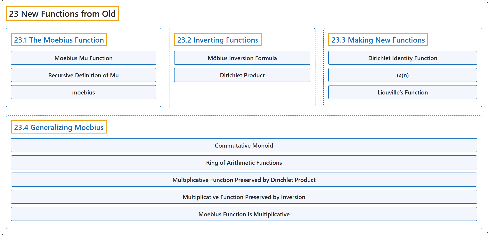

# 23 New Functions from Old

## Classification

## Glossary

| Term | Definition | 中文翻译 | Source |
|---|---|---|---|
| **23 New Functions from Old** 由旧函数得新函数 | (No definition) | （无定义） | [Crisman, 2024, chapter 23](https://math.gordon.edu/ntic/ntic/chapter-new-functions.html) |
| **[23.1 The Moebius Function](23-1-the-moebius-function.md)** 默比乌斯函数 | (No definition) | （无定义） | [Crisman, 2024, section 23.1](https://math.gordon.edu/ntic/ntic/section-moebius-mu.html) |
| **[23.2 Inverting Functions](23-2-inverting-functions.md)** 函数的反演 | (No definition) | （无定义） | [Crisman, 2024, section 23.2](https://math.gordon.edu/ntic/ntic/section-invert-funcs.html) |
| **[23.3 Making New Functions](23-3-making-new-functions.md)** 构造新函数 | (No definition) | （无定义） | [Crisman, 2024, section 23.3](https://math.gordon.edu/ntic/ntic/section-new-funcs.html) |
| **[23.4 Generalizing Moebius](23-4-generalizing-moebius.md)** 推广默比乌斯函数 | (No definition) | （无定义） | [Crisman, 2024, section 23.4](https://math.gordon.edu/ntic/ntic/section-gen-moebius.html) |

## References

Crisman, K.-D. (2024). *Number theory: In context and interactive* (June 26, 2024 edition). Gordon College. Retrieved October 29, 2026, from <https://math.gordon.edu/ntic/ntic/>
