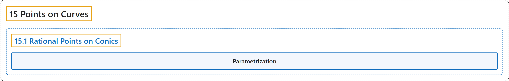

# 15.1 Rational Points on Conics

## Classification

## Glossary

| Term | Definition | 中文翻译 | Source |
|---|---|---|---|
| **15.1 Rational Points on Conics** 圆锥曲线上的有理点 | "Suppose you have a curve given by a quadratic equation with rational coefficients which contains *at least one* rational point. Then **all lines with rational slope (including vertical lines) through that point on the curve intersect the curve in *only* rational points, and *all* rational points on the curve are generated in this way**." | 设一条曲线由有理系数的二次方程给出，且至少含有*一个*有理点。那么**过曲线上这一点、斜率为有理数的所有直线（包括竖直线）与曲线只交于有理点，并且曲线上的*所有*有理点都由此得到**。 | [Crisman, 2024, Fact 15.1.5](https://math.gordon.edu/ntic/ntic/section-rational-conics.html#fact-rational-points-conic) |
| **Parametrization** 参数化 | "Even the inputs $t=0$ and $t=\infty$ have an appropriate interpretation in this framework. Such **a description of the (rational) points of the circle** is called a **parametrization**." | 即使输入 $t=0$ 和 $t=\infty$，在这个框架中也有恰当的解释。这样**对圆上（有理）点的描述**称为**参数化**。 | [Crisman, 2024, subsection 15.1.1](https://math.gordon.edu/ntic/ntic/section-rational-conics.html#subsection-rational-circle-9) |

## References

Crisman, K.-D. (2024). *Number theory: In context and interactive* (June 26, 2024 edition). Gordon College. Retrieved October 29, 2026, from <https://math.gordon.edu/ntic/ntic/>
