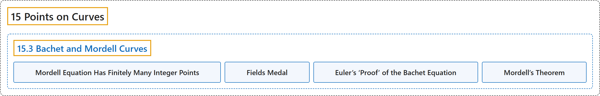

# 15.3 Bachet and Mordell Curves

## Classification

## Glossary

| Term | Definition | 中文翻译 | Source |
|---|---|---|---|
| **15.3 Bachet and Mordell Curves** 巴歇曲线与莫德尔曲线 | (No definition) | （无定义） | [Crisman, 2024, section 15.3](https://math.gordon.edu/ntic/ntic/section-mordell-curves.html) |
| **Mordell Equation Has Finitely Many Integer Points** 莫德尔方程只有有限多个整点 | "One of Mordell’s remarkable theorems states that, for a given $k$, **the equation can only have *finitely many* integer points** (in fact, there are even useful bounds for how many that depend only on the prime factorization of $k$)." | 莫德尔的一个了不起的定理说，对给定的 $k$，**这个方程只能有*有限多个*整点**（事实上，甚至还有只依赖于 $k$ 的素因数分解的、关于个数的有用的界）。 | [Crisman, 2024, section 15.3](https://math.gordon.edu/ntic/ntic/section-mordell-curves.html#section-mordell-curves-4-6) |
| **Fields Medal** 菲尔兹奖 | "Gerd Faltings won a **Fields Medal** for **proving that higher-degree curves cannot have infinitely many rational points**." | 格尔德法尔廷斯因**证明了更高次的曲线不能有无穷多个有理点**而获得**菲尔兹奖**。 | [Crisman, 2024, section 15.3](https://math.gordon.edu/ntic/ntic/section-mordell-curves.html#section-mordell-curves-4-6) |
| **Euler’s ‘Proof’ of the Bachet Equation** 欧拉对巴歇方程的“证明” | "The only positive solution to the Bachet equation is **$x=3,y=5$**." | 巴歇方程唯一的正整数解是 **$x=3,y=5$**。 | [Crisman, 2024, Fact 15.3.5](https://math.gordon.edu/ntic/ntic/section-mordell-curves.html#fact-euler-bachet) |
| **Mordell’s Theorem** 莫德尔定理 | "Essentially, **the set of (rational) points on a Mordell curve is a combination of finitely many “cyclic” (recall Fact 14.2.7) groups** (in a very specific way I will not describe), and so it can be described using finitely many of the rational points." | 本质上，**莫德尔曲线上（有理）点的集合是有限多个“循环”群（回忆事实 14.2.7）的组合**（以一种我不在此描述的特定方式），因而可以用有限多个有理点来描述。 | [Crisman, 2024, Theorem 15.3.6](https://math.gordon.edu/ntic/ntic/section-mordell-curves.html#theorem-mordell) |

## References

Crisman, K.-D. (2024). *Number theory: In context and interactive* (June 26, 2024 edition). Gordon College. Retrieved October 29, 2026, from <https://math.gordon.edu/ntic/ntic/>
