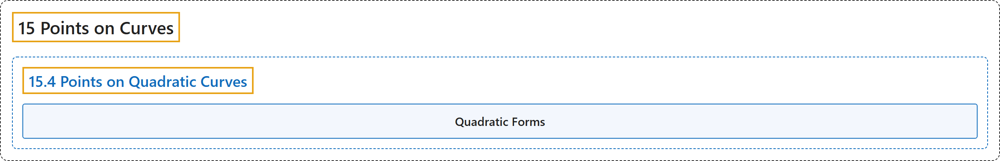

# 15.4 Points on Quadratic Curves

## Classification

## Glossary

| Term | Definition | 中文翻译 | Source |
|---|---|---|---|
| **15.4 Points on Quadratic Curves** 二次曲线上的点 | (No definition) | （无定义） | [Crisman, 2024, section 15.4](https://math.gordon.edu/ntic/ntic/section-integer-conics.html) |
| **Quadratic Forms** 二次型 | "However, one can also think of *both* conics in such a transformation as **coming from matrices**. Compare the following so-called **quadratic forms**:" | 不过，也可以把这种变换中的*两条*二次曲线都看成**来自矩阵**。比较下面这些所谓的**二次型**： | [Crisman, 2024, subsection 15.4.1](https://math.gordon.edu/ntic/ntic/section-integer-conics.html#subsection-transform-conics-4) |

## References

Crisman, K.-D. (2024). *Number theory: In context and interactive* (June 26, 2024 edition). Gordon College. Retrieved October 29, 2026, from <https://math.gordon.edu/ntic/ntic/>
