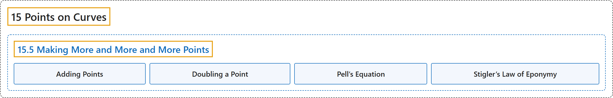

# 15.5 Making More and More and More Points

## Classification

## Glossary

| Term | Definition | 中文翻译 | Source |
|---|---|---|---|
| **15.5 Making More and More and More Points** 造出越来越多的点 | (No definition) | （无定义） | [Crisman, 2024, section 15.5](https://math.gordon.edu/ntic/ntic/section-even-more-points.html) |
| **Adding Points** 点的加法 | "Connect two points with a *secant* line, and then make a line with the same slope but through another (rational) point. We call this **adding** points." | 用一条*割*线连接两个点，然后过另一个（有理）点作一条斜率相同的直线。我们称之为**加**点。 | [Crisman, 2024, Algorithm 15.5.1](https://math.gordon.edu/ntic/ntic/section-even-more-points.html#algorithm-new-rational) |
| **Doubling a Point** 点的倍乘 | "Find the *tangent* line through a point, and then make a line with the same slope but through another point. We call this **doubling** a point." | 作过一个点的*切*线，然后过另一个点作一条斜率相同的直线。我们称之为把这个点**加倍**。 | [Crisman, 2024, Algorithm 15.5.1](https://math.gordon.edu/ntic/ntic/section-even-more-points.html#algorithm-new-rational) |
| **Pell’s Equation** 佩尔方程 | "As it turns out, this is quite an old idea. **Finding integer solutions to this hyperbola** is called solving **Pell’s equation**, and has been studied in this form since the seventeenth century." | 原来这是一个相当古老的想法。**求这条双曲线的整数解**称为解**佩尔方程**，自十七世纪起就以这种形式被研究。 | [Crisman, 2024, subsection 15.5.1](https://math.gordon.edu/ntic/ntic/section-even-more-points.html#subsection-toward-conic-integer-11) |
| **Stigler’s Law of Eponymy** 斯蒂格勒命名定律 | "In mathematics this phenomenon of **not naming things after the actual discoverer** is sometimes called Boyer’s law, more generally **Stigler’s law of eponymy** (which are themselves self-referential)." | 在数学中，这种**不以真正的发现者给事物命名**的现象有时称为博耶定律，更一般地称为**斯蒂格勒命名定律**（它们本身就是自指的）。 | [Crisman, 2024, Historical remark 15.5.7](https://math.gordon.edu/ntic/ntic/section-even-more-points.html#remark-pell-boyer) |

## References

Crisman, K.-D. (2024). *Number theory: In context and interactive* (June 26, 2024 edition). Gordon College. Retrieved October 29, 2026, from <https://math.gordon.edu/ntic/ntic/>
