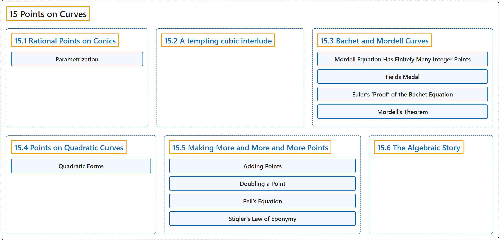

# 15 Points on Curves

## Classification

## Glossary

| Term | Definition | 中文翻译 | Source |
|---|---|---|---|
| **15 Points on Curves** 曲线上的点 | (No definition) | （无定义） | [Crisman, 2024, chapter 15](https://math.gordon.edu/ntic/ntic/chapter-points-on-curves.html) |
| **[15.1 Rational Points on Conics](15-1-rational-points-on-conics.md)** 圆锥曲线上的有理点 | (No definition) | （无定义） | [Crisman, 2024, section 15.1](https://math.gordon.edu/ntic/ntic/section-rational-conics.html) |
| **[15.2 A tempting cubic interlude](15-2-a-tempting-cubic-interlude.md)** 诱人的三次插曲 | (No definition) | （无定义） | [Crisman, 2024, section 15.2](https://math.gordon.edu/ntic/ntic/section-more-points.html) |
| **[15.3 Bachet and Mordell Curves](15-3-bachet-and-mordell-curves.md)** 巴歇曲线与莫德尔曲线 | (No definition) | （无定义） | [Crisman, 2024, section 15.3](https://math.gordon.edu/ntic/ntic/section-mordell-curves.html) |
| **[15.4 Points on Quadratic Curves](15-4-points-on-quadratic-curves.md)** 二次曲线上的点 | (No definition) | （无定义） | [Crisman, 2024, section 15.4](https://math.gordon.edu/ntic/ntic/section-integer-conics.html) |
| **[15.5 Making More and More and More Points](15-5-making-more-and-more-and-more-points.md)** 造出越来越多的点 | (No definition) | （无定义） | [Crisman, 2024, section 15.5](https://math.gordon.edu/ntic/ntic/section-even-more-points.html) |
| **[15.6 The Algebraic Story](15-6-the-algebraic-story.md)** 代数的故事 | (No definition) | （无定义） | [Crisman, 2024, section 15.6](https://math.gordon.edu/ntic/ntic/section-algebraic-points.html) |

## References

Crisman, K.-D. (2024). *Number theory: In context and interactive* (June 26, 2024 edition). Gordon College. Retrieved October 29, 2026, from <https://math.gordon.edu/ntic/ntic/>
