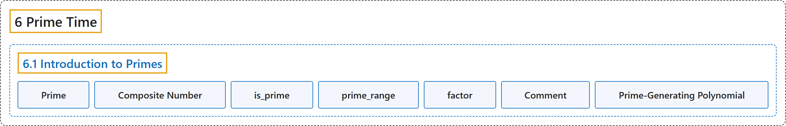

# 6.1 Introduction to Primes

## Classification

## Glossary

| Term | Definition | 中文翻译 | Source |
|---|---|---|---|
| **6.1 Introduction to Primes** 素数简介 | (No definition) | （无定义） | [Crisman, 2024, section 6.1](https://math.gordon.edu/ntic/ntic/section-prime-intro.html) |
| **Prime** 素数 | "A positive integer $p$ greater than 1 is called **prime** if **the only positive divisors of $p$ are $1$ and $p$ itself**." | 大于 1 的正整数 $p$，若**它的正因数只有 $1$ 和 $p$ 本身**，就称为**素数**。 | [Crisman, 2024, Definition 6.1.1](https://math.gordon.edu/ntic/ntic/section-prime-intro.html#definition-prime) |
| **Composite Number** 合数 | "If an integer $n\gt 1$ is **not prime**, it is called **composite**." | 整数 $n\gt 1$ 若**不是素数**，就称为**合数**。 | [Crisman, 2024, Definition 6.1.2](https://math.gordon.edu/ntic/ntic/section-prime-intro.html#definition-composite) |
| **is_prime** is_prime | "Here are answers to questions you might have about primes that Sage could answer. **Is a given number prime?**" | 下面是你可能会问的、Sage 能回答的关于素数的问题。**给定的数是素数吗？** | [Crisman, 2024, subsection 6.1.1](https://math.gordon.edu/ntic/ntic/section-prime-intro.html#subsection-prime-defn-5-1-1) |
| **prime_range** prime_range | "**List some primes for me!**" | **给我列出一些素数！** | [Crisman, 2024, subsection 6.1.1](https://math.gordon.edu/ntic/ntic/section-prime-intro.html#subsection-prime-defn-5-1-3) |
| **factor** factor | "**Give me prime factors.**" | **给我素因数。** | [Crisman, 2024, subsection 6.1.1](https://math.gordon.edu/ntic/ntic/section-prime-intro.html#subsection-prime-defn-5-1-5) |
| **Comment** 注释 | "Sometimes we might want to have **notes about the code included without being actual code**. In the Python language, such **comments** must come after `#` signs." | 有时我们想在代码里放一些**不作为真正代码的说明**。在 Python 语言中，这样的**注释**必须写在 `#` 号之后。 | [Crisman, 2024, Sage note 6.1.3](https://math.gordon.edu/ntic/ntic/section-prime-intro.html#sagenote-making-comments) |
| **Prime-Generating Polynomial** 生成素数的多项式 | "There are other **single-variable polynomials that do happen to generate a number of primes**; an impressive one follows." | 还有一些**确实能生成不少素数的单变量多项式**；下面是一个令人印象深刻的例子。 | [Crisman, 2024, subsection 6.1.2](https://math.gordon.edu/ntic/ntic/section-prime-intro.html#subsection-prime-fun-10) |

## References

Crisman, K.-D. (2024). *Number theory: In context and interactive* (June 26, 2024 edition). Gordon College. Retrieved October 29, 2026, from <https://math.gordon.edu/ntic/ntic/>
