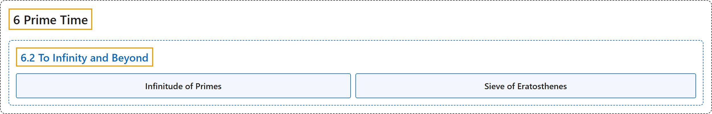

# 6.2 To Infinity and Beyond

## Classification

## Glossary

| Term | Definition | 中文翻译 | Source |
|---|---|---|---|
| **6.2 To Infinity and Beyond** 无穷及更远 | (No definition) | （无定义） | [Crisman, 2024, section 6.2](https://math.gordon.edu/ntic/ntic/section-inf-primes.html) |
| **Infinitude of Primes** 素数的无穷性 | "**There is no upper bound on the size of the collection of prime numbers.**" | **素数集合的大小没有上界。** | [Crisman, 2024, Theorem 6.2.1](https://math.gordon.edu/ntic/ntic/section-inf-primes.html#theorem-infinitude-primes) |
| **Sieve of Eratosthenes** 埃拉托色尼筛法 | "To check whether a number $n\gt 1$ is composite or prime, **it suffices to divide by all primes $p\leq \sqrt{n}$**. **Anything that isn’t divisible by these is prime.**" | 要检验数 $n\gt 1$ 是合数还是素数，**只需用所有 $p\leq \sqrt{n}$ 的素数去除**。**不能被这些素数整除的就是素数。** | [Crisman, 2024, Algorithm 6.2.3](https://math.gordon.edu/ntic/ntic/section-inf-primes.html#algorithm-sieve-erato) |

## References

Crisman, K.-D. (2024). *Number theory: In context and interactive* (June 26, 2024 edition). Gordon College. Retrieved October 29, 2026, from <https://math.gordon.edu/ntic/ntic/>
