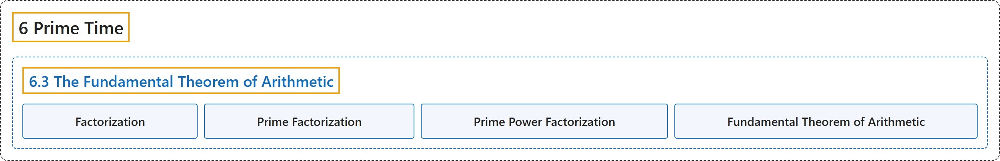

# 6.3 The Fundamental Theorem of Arithmetic

## Classification

## Glossary

| Term | Definition | 中文翻译 | Source |
|---|---|---|---|
| **6.3 The Fundamental Theorem of Arithmetic** 算术基本定理 | (No definition) | （无定义） | [Crisman, 2024, section 6.3](https://math.gordon.edu/ntic/ntic/section-fta.html) |
| **Factorization** 因数分解 | "A **factorization** of an integer is **a way of writing it as a product of integers**." | 整数的**因数分解**是**把它写成若干整数之积的一种方式**。 | [Crisman, 2024, Definition 6.3.1](https://math.gordon.edu/ntic/ntic/section-fta.html#definition-factorization) |
| **Prime Factorization** 素因数分解 | "A factorization of an integer is a way of writing it as a product of integers. This nearly always refers to one of two things, which are mentioned explicitly if there is danger of ambiguity: A **product of *prime* numbers** is called a **prime factorization**." | 整数的因数分解是把它写成若干整数之积的一种方式。它几乎总是指下面两者之一，有歧义时会明确说出：**若干*素数*之积**称为**素因数分解**。 | [Crisman, 2024, Definition 6.3.1](https://math.gordon.edu/ntic/ntic/section-fta.html#definition-factorization) |
| **Prime Power Factorization** 素数幂分解 | "A factorization of an integer is a way of writing it as a product of integers. This nearly always refers to one of two things, which are mentioned explicitly if there is danger of ambiguity: A product of *prime* numbers is called a prime factorization. A **product into positive powers of (distinct) primes** is called a **prime power factorization**." | 整数的因数分解是把它写成若干整数之积的一种方式。它几乎总是指下面两者之一，有歧义时会明确说出：若干*素数*之积称为素因数分解。**分解成（不同）素数的正整数次幂之积**称为**素数幂分解**。 | [Crisman, 2024, Definition 6.3.1](https://math.gordon.edu/ntic/ntic/section-fta.html#definition-factorization) |
| **Fundamental Theorem of Arithmetic** 算术基本定理 | "The following are true: **Every integer $N\gt 1$ has a prime factorization.** **Every such factorization of a given $n$ is the same if you put the prime factors in nondecreasing order (uniqueness).**" | 下面两条成立：**每个整数 $N\gt 1$ 都有素因数分解。** **把素因数按非降顺序排列后，给定 $n$ 的每个这样的分解都相同（唯一性）。** | [Crisman, 2024, Theorem 6.3.2](https://math.gordon.edu/ntic/ntic/section-fta.html#theorem-fta) |

## References

Crisman, K.-D. (2024). *Number theory: In context and interactive* (June 26, 2024 edition). Gordon College. Retrieved October 29, 2026, from <https://math.gordon.edu/ntic/ntic/>
