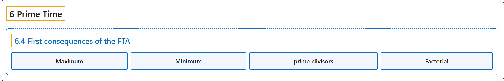

# 6.4 First consequences of the FTA

## Classification

## Glossary

| Term | Definition | 中文翻译 | Source |
|---|---|---|---|
| **6.4 First consequences of the FTA** 算术基本定理的初步推论 | (No definition) | （无定义） | [Crisman, 2024, section 6.4](https://math.gordon.edu/ntic/ntic/section-fta-consequences.html) |
| **Maximum** 最大值 | "Given two numbers $x\leq y$, we let the **maximum** and **minimum** be defined by $\max(x,y)=y\text{ and }\min(x,y)=x$ with an obvious extension to a min or max of a set consisting of more than two numbers." | 给定两个数 $x\leq y$，令**最大值**和**最小值**定义为 $\max(x,y)=y\text{ and }\min(x,y)=x$，并显然地推广到由两个以上的数组成的集合的最小值或最大值。 | [Crisman, 2024, Definition 6.4.3](https://math.gordon.edu/ntic/ntic/section-fta-consequences.html#definition-min-max) |
| **Minimum** 最小值 | "Given two numbers $x\leq y$, we let the **maximum** and **minimum** be defined by $\max(x,y)=y\text{ and }\min(x,y)=x$ with an obvious extension to a min or max of a set consisting of more than two numbers." | 给定两个数 $x\leq y$，令**最大值**和**最小值**定义为 $\max(x,y)=y\text{ and }\min(x,y)=x$，并显然地推广到由两个以上的数组成的集合的最小值或最大值。 | [Crisman, 2024, Definition 6.4.3](https://math.gordon.edu/ntic/ntic/section-fta-consequences.html#definition-min-max) |
| **prime_divisors** prime_divisors | "Next are some ways to calculate these concepts in Sage. Simply replace the numbers below with ones you are interested in. Note that the first of these functions gives **just a list of the prime divisors**, while the second one gives the full prime power factorization." | 下面是在 Sage 中计算这些概念的几种方法。只需把下面的数换成你感兴趣的数。注意这些函数中的第一个只给出**素因数的列表**，第二个则给出完整的素数幂分解。 | [Crisman, 2024, section 6.4](https://math.gordon.edu/ntic/ntic/section-fta-consequences.html#section-fta-consequences-14) |
| **Factorial** 阶乘 | "We write $n!$ for **the product of the integers from $1$ to $n$**, called $n$ **factorial**." | 我们把**从 $1$ 到 $n$ 的整数之积**记作 $n!$，称为 $n$ 的**阶乘**。 | [Crisman, 2024, Definition 6.4.6](https://math.gordon.edu/ntic/ntic/section-fta-consequences.html#definition-factorial) |

## References

Crisman, K.-D. (2024). *Number theory: In context and interactive* (June 26, 2024 edition). Gordon College. Retrieved October 29, 2026, from <https://math.gordon.edu/ntic/ntic/>
