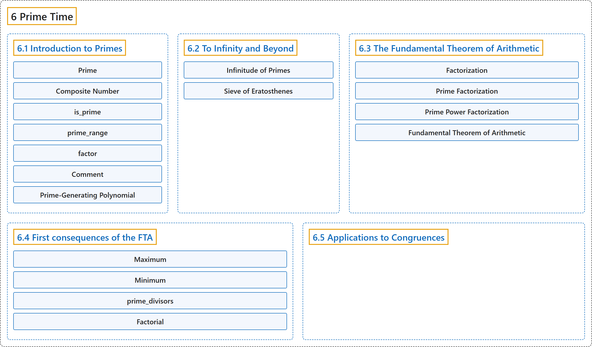

# 6 Prime Time

## Classification

## Glossary

| Term | Definition | 中文翻译 | Source |
|---|---|---|---|
| **6 Prime Time** 素数时间 | (No definition) | （无定义） | [Crisman, 2024, chapter 6](https://math.gordon.edu/ntic/ntic/chapter-prime-time.html) |
| **[6.1 Introduction to Primes](6-1-introduction-to-primes.md)** 素数简介 | (No definition) | （无定义） | [Crisman, 2024, section 6.1](https://math.gordon.edu/ntic/ntic/section-prime-intro.html) |
| **[6.2 To Infinity and Beyond](6-2-to-infinity-and-beyond.md)** 无穷及更远 | (No definition) | （无定义） | [Crisman, 2024, section 6.2](https://math.gordon.edu/ntic/ntic/section-inf-primes.html) |
| **[6.3 The Fundamental Theorem of Arithmetic](6-3-the-fundamental-theorem-of-arithmetic.md)** 算术基本定理 | (No definition) | （无定义） | [Crisman, 2024, section 6.3](https://math.gordon.edu/ntic/ntic/section-fta.html) |
| **[6.4 First consequences of the FTA](6-4-first-consequences-of-the-fta.md)** 算术基本定理的初步推论 | (No definition) | （无定义） | [Crisman, 2024, section 6.4](https://math.gordon.edu/ntic/ntic/section-fta-consequences.html) |
| **[6.5 Applications to Congruences](6-5-applications-to-congruences.md)** 在同余中的应用 | (No definition) | （无定义） | [Crisman, 2024, section 6.5](https://math.gordon.edu/ntic/ntic/section-application-primes-congruences.html) |

## References

Crisman, K.-D. (2024). *Number theory: In context and interactive* (June 26, 2024 edition). Gordon College. Retrieved October 29, 2026, from <https://math.gordon.edu/ntic/ntic/>
