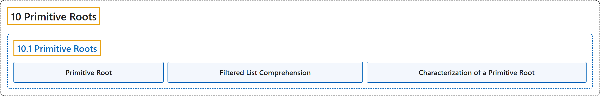

# 10.1 Primitive Roots

## Classification

## Glossary

| Term | Definition | 中文翻译 | Source |
|---|---|---|---|
| **10.1 Primitive Roots** 原根 | (No definition) | （无定义） | [Crisman, 2024, section 10.1](https://math.gordon.edu/ntic/ntic/section-prim-roots.html) |
| **Primitive Root** 原根 | "We say that $a\in U_n$ is a **primitive root** of $n$ when **$a^b$ runs through all elements of $U_n$ for $1\leq b\leq \phi(n)$**." | 若当 $1\leq b\leq \phi(n)$ 时 **$a^b$ 取遍 $U_n$ 的所有元素**，就称 $a\in U_n$ 是 $n$ 的一个**原根**。 | [Crisman, 2024, Definition 10.1.1](https://math.gordon.edu/ntic/ntic/section-prim-roots.html#definition-primitive-root) |
| **Filtered List Comprehension** 带过滤的列表推导式 | "The syntax `[x for y in range(1,mod) if func(x)]` takes list comprehensions to another level, by **‘filtering’**. This allows us to **remove from the list anything which doesn’t fit what we want**." | 语法 `[x for y in range(1,mod) if func(x)]` 通过“**过滤**”把列表推导式提升了一个层次。它让我们能**从列表中去掉任何不符合要求的东西**。 | [Crisman, 2024, Sage note 10.1.3](https://math.gordon.edu/ntic/ntic/section-prim-roots.html#sagenote-filter-list-comp) |
| **Characterization of a Primitive Root** 原根的刻画 | "There are two equivalent ways to characterize/define a primitive root of $n$ among numbers such that $\gcd(a,n)=1$. We say that $a$ is a **primitive root** of $n$ if **$a^b$ yields every element of $U_n$**. We say that $a$ is a **primitive root** of $n$ if **the *order* of $a$ is $\phi(n)$**." | 在满足 $\gcd(a,n)=1$ 的数中，有两种等价的方式来刻画（定义）$n$ 的原根。若 **$a^b$ 能得到 $U_n$ 的每个元素**，就称 $a$ 是 $n$ 的**原根**。若 **$a$ 的*阶*是 $\phi(n)$**，就称 $a$ 是 $n$ 的**原根**。 | [Crisman, 2024, Proposition 10.1.4](https://math.gordon.edu/ntic/ntic/section-prim-roots.html#prop-charact-prim-root) |

## References

Crisman, K.-D. (2024). *Number theory: In context and interactive* (June 26, 2024 edition). Gordon College. Retrieved October 29, 2026, from <https://math.gordon.edu/ntic/ntic/>
