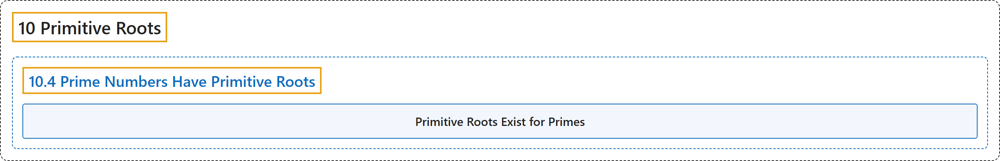

# 10.4 Prime Numbers Have Primitive Roots

## Classification

## Glossary

| Term | Definition | 中文翻译 | Source |
|---|---|---|---|
| **10.4 Prime Numbers Have Primitive Roots** 素数有原根 | (No definition) | （无定义） | [Crisman, 2024, section 10.4](https://math.gordon.edu/ntic/ntic/section-primes-prim.html) |
| **Primitive Roots Exist for Primes** 素数存在原根 | "**Every prime has a primitive root.** In other words, the order $p-1$ group $U_p$ is always cyclic." | **每个素数都有原根**。换句话说，阶为 $p-1$ 的群 $U_p$ 总是循环群。 | [Crisman, 2024, Theorem 10.4.1](https://math.gordon.edu/ntic/ntic/section-primes-prim.html#theorem-primitive-root-primes) |

## References

Crisman, K.-D. (2024). *Number theory: In context and interactive* (June 26, 2024 edition). Gordon College. Retrieved October 29, 2026, from <https://math.gordon.edu/ntic/ntic/>
