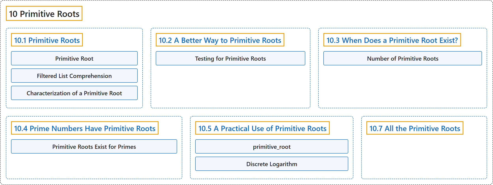

# 10 Primitive Roots

## Classification

## Glossary

| Term | Definition | 中文翻译 | Source |
|---|---|---|---|
| **10 Primitive Roots** 原根 | (No definition) | （无定义） | [Crisman, 2024, chapter 10](https://math.gordon.edu/ntic/ntic/chapter-primitive-roots.html) |
| **[10.1 Primitive Roots](10-1-primitive-roots.md)** 原根 | (No definition) | （无定义） | [Crisman, 2024, section 10.1](https://math.gordon.edu/ntic/ntic/section-prim-roots.html) |
| **[10.2 A Better Way to Primitive Roots](10-2-a-better-way-to-primitive-roots.md)** 求原根的更好方法 | (No definition) | （无定义） | [Crisman, 2024, section 10.2](https://math.gordon.edu/ntic/ntic/section-better-prim.html) |
| **[10.3 When Does a Primitive Root Exist?](10-3-when-does-a-primitive-root-exist.md)** 原根何时存在？ | (No definition) | （无定义） | [Crisman, 2024, section 10.3](https://math.gordon.edu/ntic/ntic/section-when-prim.html) |
| **[10.4 Prime Numbers Have Primitive Roots](10-4-prime-numbers-have-primitive-roots.md)** 素数有原根 | (No definition) | （无定义） | [Crisman, 2024, section 10.4](https://math.gordon.edu/ntic/ntic/section-primes-prim.html) |
| **[10.5 A Practical Use of Primitive Roots](10-5-a-practical-use-of-primitive-roots.md)** 原根的一个实际用途 | (No definition) | （无定义） | [Crisman, 2024, section 10.5](https://math.gordon.edu/ntic/ntic/section-practical-prim.html) |
| **[10.7 All the Primitive Roots](10-7-all-the-primitive-roots.md)** 全部原根 | (No definition) | （无定义） | [Crisman, 2024, section 10.7](https://math.gordon.edu/ntic/ntic/section-all-primitive.html) |

## References

Crisman, K.-D. (2024). *Number theory: In context and interactive* (June 26, 2024 edition). Gordon College. Retrieved October 29, 2026, from <https://math.gordon.edu/ntic/ntic/>
