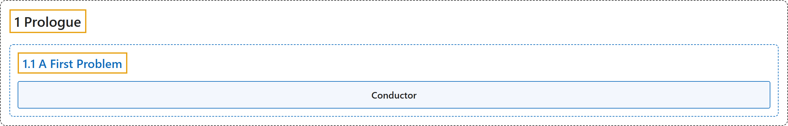

# 1.1 A First Problem

## Classification

## Glossary

| Term | Definition | 中文翻译 | Source |
|---|---|---|---|
| **1.1 A First Problem** 第一个问题 | (No definition) | （无定义） | [Crisman, 2024, section 1.1](https://math.gordon.edu/ntic/ntic/first-prob.html) |
| **Conductor** 导子 | "In this case, after some experimentation, it looks like only 1, 2, and 5 are not possible, so anything six or above is possible. We call **this number (in this case, 6)** the **conductor** of the set $\{3,4\}$." | 在这种情况下，经过一些试验，看起来只有 1、2 和 5 凑不出来，所以 6 及以上的都能凑出来。我们把**这个数**（这里是 6）称为集合 $\{3,4\}$ 的**导子**。 | [Crisman, 2024, section 1.1](https://math.gordon.edu/ntic/ntic/first-prob.html#first-prob-5) |

## References

Crisman, K.-D. (2024). *Number theory: In context and interactive* (June 26, 2024 edition). Gordon College. Retrieved October 29, 2026, from <https://math.gordon.edu/ntic/ntic/>
