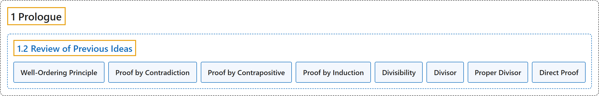

# 1.2 Review of Previous Ideas

## Classification

## Glossary

| Term | Definition | 中文翻译 | Source |
|---|---|---|---|
| **1.2 Review of Previous Ideas** 已有知识回顾 | (No definition) | （无定义） | [Crisman, 2024, section 1.2](https://math.gordon.edu/ntic/ntic/first-review.html) |
| **Well-Ordering Principle** 良序原理 | "**Any nonempty set of positive integers has a least/smallest element.**" | **任何非空的正整数集合都有最小元素。** | [Crisman, 2024, Axiom 1.2.1](https://math.gordon.edu/ntic/ntic/first-review.html#axiom-well-ordering) |
| **Proof by Contradiction** 反证法 | "To review, proofs by **contradiction** and contrapositive both start by **assuming the negation of the conclusion**. A proof by contrapositive uses that assumption to prove the negation of the original assumption. A **proof by contradiction**, on the other hand, **leads to some absurdity**, but not necessarily just negating the original assumptions." | 回顾一下，**反证法**和逆否证法都从**假设结论的否定**开始。逆否证法用这个假设去证明原来假设的否定。而**反证法**则**导出某种荒谬**，不一定只是否定原来的假设。 | [Crisman, 2024, Remark 1.2.3](https://math.gordon.edu/ntic/ntic/first-review.html#remark-proofs-contra) |
| **Proof by Contrapositive** 逆否证法 | "To review, proofs by contradiction and **contrapositive** both start by **assuming the negation of the conclusion**. A **proof by contrapositive** uses that assumption **to prove the negation of the original assumption**." | 回顾一下，反证法和**逆否证法**都从**假设结论的否定**开始。**逆否证法**用这个假设**去证明原来假设的否定**。 | [Crisman, 2024, Remark 1.2.3](https://math.gordon.edu/ntic/ntic/first-review.html#remark-proofs-contra) |
| **Proof by Induction** 归纳法证明 | "Sometimes we need a way to **prove a statement for all integers $n$ after a certain point**, for instance integers greater than or equal to $n=1$. This is usually called **proof by induction**." | 有时我们需要一种方法来**对某一点之后的所有整数 $n$ 证明一个命题**，例如对所有大于或等于 $n=1$ 的整数。这通常称为**归纳法证明**。 | [Crisman, 2024, subsection 1.2.2](https://math.gordon.edu/ntic/ntic/first-review.html#subsection-induction-4) |
| **Divisibility** 整除 | "If an integer $n$ can be written as **a product $kd=n$ of two integers $k$ and $d$**, then we say that $d$ **divides** $n$, or that $n$ is **divisible** by $d$, or that $d$ is a divisor of $n$. We write $d\mid n$ to denote that $d$ divides $n$." | 若整数 $n$ 能写成**两个整数 $k$ 与 $d$ 的乘积 $kd=n$**，则称 $d$ **整除** $n$，或 $n$ **能被** $d$ **整除**，或 $d$ 是 $n$ 的因数。我们用 $d\mid n$ 表示 $d$ 整除 $n$。 | [Crisman, 2024, Definition 1.2.5](https://math.gordon.edu/ntic/ntic/first-review.html#defn-divisibility) |
| **Divisor** 因数 | "If an integer $n$ can be written as **a product $kd=n$ of two integers $k$ and $d$**, then we say that $d$ divides $n$, or that $n$ is divisible by $d$, or that $d$ is a **divisor** of $n$." | 若整数 $n$ 能写成**两个整数 $k$ 与 $d$ 的乘积 $kd=n$**，则称 $d$ 整除 $n$，或 $n$ 能被 $d$ 整除，或 $d$ 是 $n$ 的**因数**。 | [Crisman, 2024, Definition 1.2.5](https://math.gordon.edu/ntic/ntic/first-review.html#defn-divisibility) |
| **Proper Divisor** 真因数 | "We occasionally use the term **proper divisor** to denote **a positive divisor of $n$ which is not $n$**." | 我们有时用**真因数**这个词来表示 **$n$ 的不等于 $n$ 的正因数**。 | [Crisman, 2024, Example 1.2.6](https://math.gordon.edu/ntic/ntic/first-review.html#example-divisibility) |
| **Direct Proof** 直接证明 | "These are not hard to prove (see Exercise 1.4.1) using **direct proof**, where **no indirect or inductive steps are needed**." | 这些用**直接证明**不难证明（见习题 1.4.1），**不需要任何间接或归纳的步骤**。 | [Crisman, 2024, subsection 1.2.3](https://math.gordon.edu/ntic/ntic/first-review.html#subsection-divisibility-8) |

## References

Crisman, K.-D. (2024). *Number theory: In context and interactive* (June 26, 2024 edition). Gordon College. Retrieved October 29, 2026, from <https://math.gordon.edu/ntic/ntic/>
