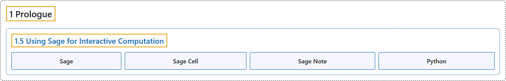

# 1.5 Using Sage for Interactive Computation

## Classification

## Glossary

| Term | Definition | 中文翻译 | Source |
|---|---|---|---|
| **1.5 Using Sage for Interactive Computation** 用 Sage 做交互式计算 | (No definition) | （无定义） | [Crisman, 2024, section 1.5](https://math.gordon.edu/ntic/ntic/section-using-computation.html) |
| **Sage** Sage | "Assuming you’re connected to the internet, this very first cell will use **SageMath** (usually just called **Sage**) to check whether a given fraction remains a fraction when reduced, or whether it reduces to an integer." | 假设你已联网，这第一个单元会用 **SageMath**（通常就叫 **Sage**）来检查一个给定的分数约分后仍是分数，还是约成了整数。 | [Crisman, 2024, section 1.5](https://math.gordon.edu/ntic/ntic/section-using-computation.html#section-using-computation-6) |
| **Sage Cell** Sage 单元 | "In the interactive version of this text, **the areas below** are called **Sage cells**, or cells for short." | 在本书的交互版中，**下面这些区域**称为 **Sage 单元**，简称单元。 | [Crisman, 2024, section 1.5](https://math.gordon.edu/ntic/ntic/section-using-computation.html#section-using-computation-6) |
| **Sage Note** Sage 注记 | "**Sage notes** will **teach you useful things about basic programming, or more general facts about Sage and Python**, the computer language Sage is based on." | **Sage 注记**会**教你一些基础编程的有用知识，或关于 Sage 和 Python 的更一般的事实**；Python 是 Sage 所基于的计算机语言。 | [Crisman, 2024, Sage note 1.5.1](https://math.gordon.edu/ntic/ntic/section-using-computation.html#sagenote-about-sage-note) |
| **Python** Python | "Sage notes will teach you useful things about basic programming, or more general facts about Sage and **Python**, **the computer language Sage is based on**." | Sage 注记会教你一些基础编程的有用知识，或关于 Sage 和 **Python** 的更一般的事实；Python 是 **Sage 所基于的计算机语言**。 | [Crisman, 2024, Sage note 1.5.1](https://math.gordon.edu/ntic/ntic/section-using-computation.html#sagenote-about-sage-note) |

## References

Crisman, K.-D. (2024). *Number theory: In context and interactive* (June 26, 2024 edition). Gordon College. Retrieved October 29, 2026, from <https://math.gordon.edu/ntic/ntic/>
