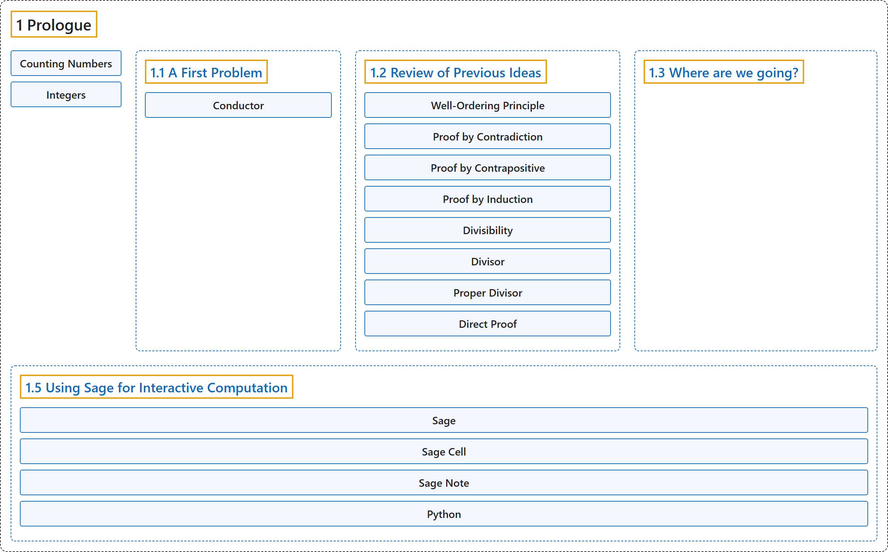

# 1 Prologue

## Classification

## Glossary

| Term | Definition | 中文翻译 | Source |
|---|---|---|---|
| **1 Prologue** 序章 | (No definition) | （无定义） | [Crisman, 2024, chapter 1](https://math.gordon.edu/ntic/ntic/chapter-prologue.html) |
| **Counting Numbers** 计数数 | "The set of **counting numbers** is denoted $\mathbb{N} = \{0,1,2,3,4,\cdots\}$." | **计数数**的集合记作 $\mathbb{N} = \{0,1,2,3,4,\cdots\}$。 | [Crisman, 2024, Definition 1.0.1](https://math.gordon.edu/ntic/ntic/chapter-prologue.html#defn-integers) |
| **Integers** 整数 | "The **integers** is **the set of positive *and* negative counting numbers**: $\mathbb{Z} = \{ \cdots ,-3,-2,-1,0,1,2,3,\cdots \}$." | **整数**是**正的*和*负的计数数组成的集合**：$\mathbb{Z} = \{ \cdots ,-3,-2,-1,0,1,2,3,\cdots \}$。 | [Crisman, 2024, Definition 1.0.1](https://math.gordon.edu/ntic/ntic/chapter-prologue.html#defn-integers) |
| **[1.1 A First Problem](1-1-a-first-problem.md)** 第一个问题 | (No definition) | （无定义） | [Crisman, 2024, section 1.1](https://math.gordon.edu/ntic/ntic/first-prob.html) |
| **[1.2 Review of Previous Ideas](1-2-review-of-previous-ideas.md)** 已有知识回顾 | (No definition) | （无定义） | [Crisman, 2024, section 1.2](https://math.gordon.edu/ntic/ntic/first-review.html) |
| **[1.3 Where are we going?](1-3-where-are-we-going.md)** 我们要去哪里？ | (No definition) | （无定义） | [Crisman, 2024, section 1.3](https://math.gordon.edu/ntic/ntic/section-quo-vadis.html) |
| **[1.5 Using Sage for Interactive Computation](1-5-using-sage-for-interactive-computation.md)** 用 Sage 做交互式计算 | (No definition) | （无定义） | [Crisman, 2024, section 1.5](https://math.gordon.edu/ntic/ntic/section-using-computation.html) |

## References

Crisman, K.-D. (2024). *Number theory: In context and interactive* (June 26, 2024 edition). Gordon College. Retrieved October 29, 2026, from <https://math.gordon.edu/ntic/ntic/>
