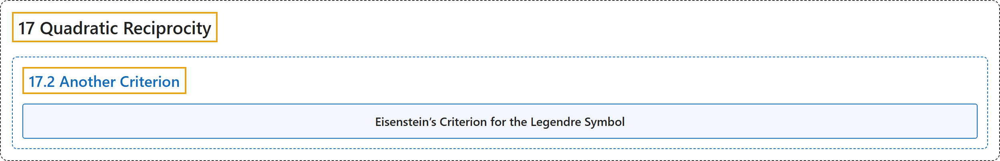

# 17.2 Another Criterion

## Classification

## Glossary

| Term | Definition | 中文翻译 | Source |
|---|---|---|---|
| **17.2 Another Criterion** 另一个判别法 | (No definition) | （无定义） | [Crisman, 2024, section 17.2](https://math.gordon.edu/ntic/ntic/section-eisen-crit.html) |
| **Eisenstein’s Criterion for the Legendre Symbol** 勒让德符号的艾森斯坦判别法 | "Let $p$ and $a$ be as throughout, and $E=\{2,4,6,\ldots,p-1\}$; then **$\left(\frac{a}{p}\right)=(-1)^{\sum_{e\in E}\left\lfloor\frac{ae}{p}\right\rfloor}$**." | 设 $p$ 和 $a$ 同前，$E=\{2,4,6,\ldots,p-1\}$；则 **$\left(\frac{a}{p}\right)=(-1)^{\sum_{e\in E}\left\lfloor\frac{ae}{p}\right\rfloor}$**。 | [Crisman, 2024, Theorem 17.2.8](https://math.gordon.edu/ntic/ntic/section-eisen-crit.html#theorem-eisenstein-criterion) |

## References

Crisman, K.-D. (2024). *Number theory: In context and interactive* (June 26, 2024 edition). Gordon College. Retrieved October 29, 2026, from <https://math.gordon.edu/ntic/ntic/>
