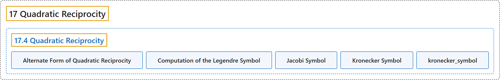

# 17.4 Quadratic Reciprocity

## Classification

## Glossary

| Term | Definition | 中文翻译 | Source |
|---|---|---|---|
| **17.4 Quadratic Reciprocity** 二次互反律 | "If $p$ and $q$ are odd primes not equal to each other, then **$\left(\frac{p}{q}\right)\left(\frac{q}{p}\right)=(-1)^{\left(\frac{p-1}{2}\right)\left(\frac{q-1}{2}\right)}$**." | 若 $p$ 和 $q$ 是互不相等的奇素数，则 **$\left(\frac{p}{q}\right)\left(\frac{q}{p}\right)=(-1)^{\left(\frac{p-1}{2}\right)\left(\frac{q-1}{2}\right)}$**。 | [Crisman, 2024, Theorem 17.4.1](https://math.gordon.edu/ntic/ntic/section-quadratic-reciprocity.html#theorem-qr) |
| **Alternate Form of Quadratic Reciprocity** 二次互反律的另一种形式 | "Note that the exponent has fractions, not Legendre symbols! We can multiply them to rewrite the exponent in a way some authors prefer: **$\left(\frac{p}{q}\right)\left(\frac{q}{p}\right)=(-1)^{\frac{(p-1)(q-1)}{4}}$**." | 注意指数里是分数，不是勒让德符号！把它们相乘，可以把指数改写成一些作者偏爱的形式：**$\left(\frac{p}{q}\right)\left(\frac{q}{p}\right)=(-1)^{\frac{(p-1)(q-1)}{4}}$**。 | [Crisman, 2024, Remark 17.4.2](https://math.gordon.edu/ntic/ntic/section-quadratic-reciprocity.html#remark-qr-rewrite) |
| **Computation of the Legendre Symbol** 勒让德符号的计算 | "Any Legendre symbol can be computed using the following steps, not necessarily in this order and often multiple times: **Factor the top** and use Proposition 16.4.7, then computing each one separately. **Reduce modulo the bottom** and/or use Proposition 17.1.3 to get convenient tops (especially perfect squares). When you get to an odd prime on the top and bottom, **use Theorem 17.4.1**. When the top is $-1$ or $2$, use Example 16.6.2 or Theorem 16.7.1 to finish your computation." | 任何勒让德符号都可以用下面的步骤来计算，不一定按这个顺序，而且常常要重复多次：**把上面的数分解**，用命题 16.4.7，再分别计算每一个。**模下面的数约化**，和（或）用命题 17.1.3 得到方便的上面的数（尤其是完全平方数）。当上下都是奇素数时，**用定理 17.4.1**。当上面是 $-1$ 或 $2$ 时，用例 16.6.2 或定理 16.7.1 完成计算。 | [Crisman, 2024, Algorithm 17.4.6](https://math.gordon.edu/ntic/ntic/section-quadratic-reciprocity.html#algorithm-compute-legendre) |
| **Jacobi Symbol** 雅可比符号 | "Let $n$ be an *odd* number which factors as $n=p_1^{e_1}p_2^{e_2}\cdots p_k^{e_k}$. Then the **Jacobi symbol**, $\left(\frac{a}{n}\right)$, is just **the product of the relevant Legendre symbols**:" | 设 $n$ 是一个*奇*数，分解为 $n=p_1^{e_1}p_2^{e_2}\cdots p_k^{e_k}$。那么**雅可比符号** $\left(\frac{a}{n}\right)$ 就是**相应的勒让德符号之积**： | [Crisman, 2024, Definition 17.4.9](https://math.gordon.edu/ntic/ntic/section-quadratic-reciprocity.html#definition-jacobi-symbol) |
| **Kronecker Symbol** 克罗内克符号 | "In Sage, this is named after **yet another generalization** called the **Kronecker symbol**." | 在 Sage 中，它以**又一种推广**命名，即**克罗内克符号**。 | [Crisman, 2024, Sage note 17.4.11](https://math.gordon.edu/ntic/ntic/section-quadratic-reciprocity.html#sagenote-name-vary) |
| **kronecker_symbol** kronecker_symbol | "In Sage, this is named after **yet another generalization** called the **Kronecker symbol**." | 在 Sage 中，它以**又一种推广**命名，即**克罗内克符号**。 | [Crisman, 2024, Sage note 17.4.11](https://math.gordon.edu/ntic/ntic/section-quadratic-reciprocity.html#sagenote-name-vary) |

## References

Crisman, K.-D. (2024). *Number theory: In context and interactive* (June 26, 2024 edition). Gordon College. Retrieved October 29, 2026, from <https://math.gordon.edu/ntic/ntic/>
