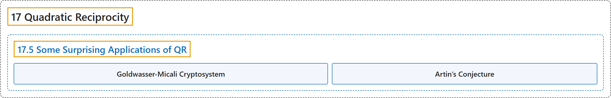

# 17.5 Some Surprising Applications of QR

## Classification

## Glossary

| Term | Definition | 中文翻译 | Source |
|---|---|---|---|
| **17.5 Some Surprising Applications of QR** 二次互反律的一些意外应用 | (No definition) | （无定义） | [Crisman, 2024, section 17.5](https://math.gordon.edu/ntic/ntic/section-quad-rec-apps.html) |
| **Goldwasser-Micali Cryptosystem** Goldwasser-Micali 密码体制 | "Then the Goldwasser-Micali cryptosystem uses the fact that **it isn’t obvious whether a Jacobi symbol which equals one implies $a$ is actually a quadratic residue** to create **a public-key cryptosystem**." | Goldwasser-Micali 密码体制利用了这样一个事实：**等于一的雅可比符号是否意味着 $a$ 真的是二次剩余并不明显**，以此构造了**一个公钥密码体制**。 | [Crisman, 2024, subsection 17.5.3](https://math.gordon.edu/ntic/ntic/section-quad-rec-apps.html#subsection-crypto-QR-4) |
| **Artin’s Conjecture** 阿廷猜想 | "**Every nonsquare integer except $-1$ is a primitive root for infinitely many primes.**" | **除 $-1$ 外，每个非平方整数都是无穷多个素数的原根**。 | [Crisman, 2024, Conjecture 17.5.3](https://math.gordon.edu/ntic/ntic/section-quad-rec-apps.html#conjecture-artin) |

## References

Crisman, K.-D. (2024). *Number theory: In context and interactive* (June 26, 2024 edition). Gordon College. Retrieved October 29, 2026, from <https://math.gordon.edu/ntic/ntic/>
