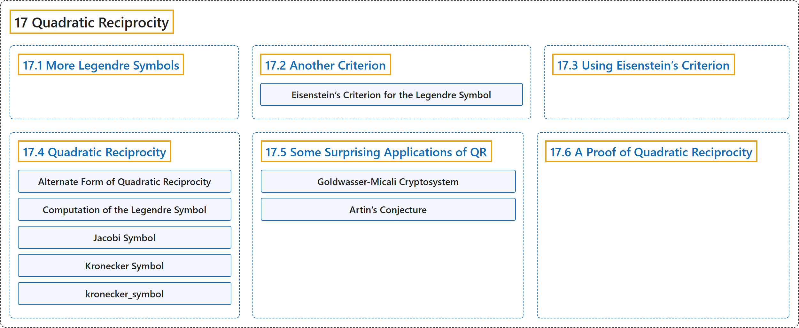

# 17 Quadratic Reciprocity

## Classification

## Glossary

| Term | Definition | 中文翻译 | Source |
|---|---|---|---|
| **17 Quadratic Reciprocity** 二次互反律 | (No definition) | （无定义） | [Crisman, 2024, chapter 17](https://math.gordon.edu/ntic/ntic/chapter-quadratic-reciprocity.html) |
| **[17.1 More Legendre Symbols](17-1-more-legendre-symbols.md)** 更多勒让德符号 | (No definition) | （无定义） | [Crisman, 2024, section 17.1](https://math.gordon.edu/ntic/ntic/section-more-legendre.html) |
| **[17.2 Another Criterion](17-2-another-criterion.md)** 另一个判别法 | (No definition) | （无定义） | [Crisman, 2024, section 17.2](https://math.gordon.edu/ntic/ntic/section-eisen-crit.html) |
| **[17.3 Using Eisenstein’s Criterion](17-3-using-eisensteins-criterion.md)** 使用艾森斯坦判别法 | (No definition) | （无定义） | [Crisman, 2024, section 17.3](https://math.gordon.edu/ntic/ntic/section-using-eisen-crit.html) |
| **[17.4 Quadratic Reciprocity](17-4-quadratic-reciprocity.md)** 二次互反律 | (No definition) | （无定义） | [Crisman, 2024, section 17.4](https://math.gordon.edu/ntic/ntic/section-quadratic-reciprocity.html) |
| **[17.5 Some Surprising Applications of QR](17-5-some-surprising-applications-of-qr.md)** 二次互反律的一些意外应用 | (No definition) | （无定义） | [Crisman, 2024, section 17.5](https://math.gordon.edu/ntic/ntic/section-quad-rec-apps.html) |
| **[17.6 A Proof of Quadratic Reciprocity](17-6-a-proof-of-quadratic-reciprocity.md)** 二次互反律的一个证明 | (No definition) | （无定义） | [Crisman, 2024, section 17.6](https://math.gordon.edu/ntic/ntic/section-quad-rec-proof.html) |

## References

Crisman, K.-D. (2024). *Number theory: In context and interactive* (June 26, 2024 edition). Gordon College. Retrieved October 29, 2026, from <https://math.gordon.edu/ntic/ntic/>
