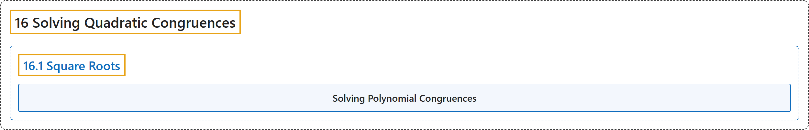

# 16.1 Square Roots

## Classification

## Glossary

| Term | Definition | 中文翻译 | Source |
|---|---|---|---|
| **16.1 Square Roots** 平方根 | (No definition) | （无定义） | [Crisman, 2024, section 16.1](https://math.gordon.edu/ntic/ntic/section-square-roots.html) |
| **Solving Polynomial Congruences** 求解多项式同余方程 | "To solve a polynomial modulo a given modulus $n$, the following information suffices, granted the technical condition for the first bullet that $\gcd(p,f'(x))=1$ for a solution $x$ modulo a prime factor $p\mid n$. If we can solve, for a given prime $p$, **$f(x)\equiv 0\text{ (mod }p)$**, we can solve **$f(x)\equiv 0\text{ (mod }p^e)$**." | 要在给定模数 $n$ 下解一个多项式，下面的信息就够了；对第一条，要求技术性条件：对模素因数 $p\mid n$ 的解 $x$ 有 $\gcd(p,f'(x))=1$。若对给定的素数 $p$ 能解 **$f(x)\equiv 0\text{ (mod }p)$**，就能解 **$f(x)\equiv 0\text{ (mod }p^e)$**。 | [Crisman, 2024, Algorithm 16.1.5](https://math.gordon.edu/ntic/ntic/section-square-roots.html#algorithm-solve-polys-mod-n) |

## References

Crisman, K.-D. (2024). *Number theory: In context and interactive* (June 26, 2024 edition). Gordon College. Retrieved October 29, 2026, from <https://math.gordon.edu/ntic/ntic/>
