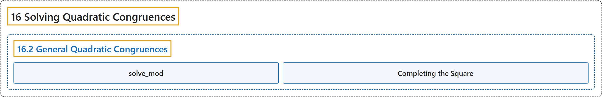

# 16.2 General Quadratic Congruences

## Classification

## Glossary

| Term | Definition | 中文翻译 | Source |
|---|---|---|---|
| **16.2 General Quadratic Congruences** 一般二次同余方程 | (No definition) | （无定义） | [Crisman, 2024, section 16.2](https://math.gordon.edu/ntic/ntic/section-quadratic-congruences.html) |
| **solve_mod** solve_mod | "Notice that the `solve_mod` command is more complicated than `divmod`. `solve_mod` returns **a list of tuples**, where a tuple of length one has a comma to indicate it’s a tuple." | 注意 `solve_mod` 命令比 `divmod` 复杂。`solve_mod` 返回**一个元组的列表**，长度为一的元组用一个逗号表示它是元组。 | [Crisman, 2024, Sage note 16.2.2](https://math.gordon.edu/ntic/ntic/section-quadratic-congruences.html#sagenote-command-soph) |
| **Completing the Square** 配方 | "To complete the square for $ax^2+bx+c\equiv 0$, the key thing to keep in mind is that ***we do not actually divide* by $2a$, but instead multiply by $(2a)^{-1}$**." | 对 $ax^2+bx+c\equiv 0$ 配方时，要记住的关键是：***我们并不真的除以* $2a$，而是乘以 $(2a)^{-1}$**。 | [Crisman, 2024, Algorithm 16.2.4](https://math.gordon.edu/ntic/ntic/section-quadratic-congruences.html#algorithm-completing-square) |

## References

Crisman, K.-D. (2024). *Number theory: In context and interactive* (June 26, 2024 edition). Gordon College. Retrieved October 29, 2026, from <https://math.gordon.edu/ntic/ntic/>
