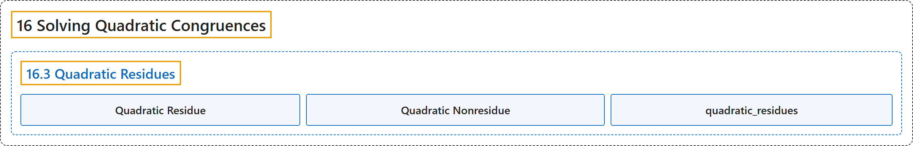

# 16.3 Quadratic Residues

## Classification

## Glossary

| Term | Definition | 中文翻译 | Source |
|---|---|---|---|
| **16.3 Quadratic Residues** 二次剩余 | (No definition) | （无定义） | [Crisman, 2024, section 16.3](https://math.gordon.edu/ntic/ntic/section-quad-residues.html) |
| **Quadratic Residue** 二次剩余 | "Assume that $a\not\equiv 0$ (mod $p$), for $p$ a prime. If **there *is* a solution of $x^2\equiv a$ (mod $p$)** we say that $a$ is a **quadratic residue** of $p$ (or a **QR**). If **there *is not* a solution of $x^2\equiv a$ (mod $p$)** we say that $a$ is a **quadratic nonresidue** of $p$." | 设 $a\not\equiv 0$（mod $p$），$p$ 为素数。若 **$x^2\equiv a$（mod $p$）*有*解**，就说 $a$ 是 $p$ 的**二次剩余**（或 **QR**）。若 **$x^2\equiv a$（mod $p$）*无*解**，就说 $a$ 是 $p$ 的**二次非剩余**。 | [Crisman, 2024, Definition 16.3.1](https://math.gordon.edu/ntic/ntic/section-quad-residues.html#definition-qr) |
| **Quadratic Nonresidue** 二次非剩余 | "Assume that $a\not\equiv 0$ (mod $p$), for $p$ a prime. If **there *is* a solution of $x^2\equiv a$ (mod $p$)** we say that $a$ is a **quadratic residue** of $p$ (or a **QR**). If **there *is not* a solution of $x^2\equiv a$ (mod $p$)** we say that $a$ is a **quadratic nonresidue** of $p$." | 设 $a\not\equiv 0$（mod $p$），$p$ 为素数。若 **$x^2\equiv a$（mod $p$）*有*解**，就说 $a$ 是 $p$ 的**二次剩余**（或 **QR**）。若 **$x^2\equiv a$（mod $p$）*无*解**，就说 $a$ 是 $p$ 的**二次非剩余**。 | [Crisman, 2024, Definition 16.3.1](https://math.gordon.edu/ntic/ntic/section-quad-residues.html#definition-qr) |
| **quadratic_residues** quadratic_residues | "Sage can **calculate these** for us, of course." | 当然，Sage 可以替我们**算出这些**。 | [Crisman, 2024, Sage note 16.3.3](https://math.gordon.edu/ntic/ntic/section-quad-residues.html#sagenote-quadratic-residues) |

## References

Crisman, K.-D. (2024). *Number theory: In context and interactive* (June 26, 2024 edition). Gordon College. Retrieved October 29, 2026, from <https://math.gordon.edu/ntic/ntic/>
