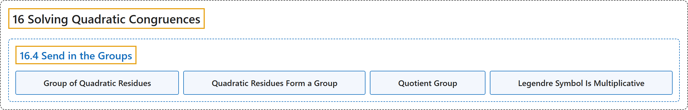

# 16.4 Send in the Groups

## Classification

## Glossary

| Term | Definition | 中文翻译 | Source |
|---|---|---|---|
| **16.4 Send in the Groups** 引入群 | (No definition) | （无定义） | [Crisman, 2024, section 16.4](https://math.gordon.edu/ntic/ntic/section-quad-groups.html) |
| **Group of Quadratic Residues** 二次剩余群 | "Consider **the set of all non-zero quadratic residues modulo some prime $p$**. We call this the **group of quadratic residues** $Q_p$." | 考虑**模某个素数 $p$ 的全体非零二次剩余组成的集合**。我们称之为**二次剩余群** $Q_p$。 | [Crisman, 2024, Definition 16.4.2](https://math.gordon.edu/ntic/ntic/section-quad-groups.html#definition-group-quad-res) |
| **Quadratic Residues Form a Group** 二次剩余构成群 | "**The set of (non-zero) quadratic residues $Q_p$ modulo a prime $p$ really is a group, and is even a subgroup of the group of units $U_p$.**" | **模素数 $p$ 的（非零）二次剩余集合 $Q_p$ 确实是一个群，甚至是单位群 $U_p$ 的子群**。 | [Crisman, 2024, Theorem 16.4.3](https://math.gordon.edu/ntic/ntic/section-quad-groups.html#theorem-qr-is-group) |
| **Quotient Group** 商群 | "For those with some additional algebraic background, it turns out $Q_p$ is in fact a **quotient group** of $U_p$ as well, but we will not delve further into this here." | 对有更多代数背景的读者来说，$Q_p$ 其实也是 $U_p$ 的一个**商群**，但这里不再深入。 | [Crisman, 2024, Remark 16.4.4](https://math.gordon.edu/ntic/ntic/section-quad-groups.html#remark-quotient-group) |
| **Legendre Symbol Is Multiplicative** 勒让德符号的积性 | "If $n=ab$ is a factorization (not necessarily nontrivial) of $n$, then **$n$ is a QR of $p$ precisely when either both $a$ and $b$ are QRs of $p$ or both $a$ and $b$ are *not* QRs of $p$**." | 若 $n=ab$ 是 $n$ 的一个分解（不一定非平凡），那么 **$n$ 是 $p$ 的 QR，当且仅当 $a$ 与 $b$ 都是 $p$ 的 QR，或者 $a$ 与 $b$ 都*不*是 $p$ 的 QR**。 | [Crisman, 2024, Proposition 16.4.7](https://math.gordon.edu/ntic/ntic/section-quad-groups.html#prop-legendre-mult) |

## References

Crisman, K.-D. (2024). *Number theory: In context and interactive* (June 26, 2024 edition). Gordon College. Retrieved October 29, 2026, from <https://math.gordon.edu/ntic/ntic/>
