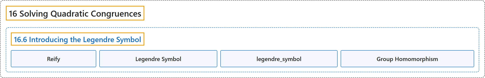

# 16.6 Introducing the Legendre Symbol

## Classification

## Glossary

| Term | Definition | 中文翻译 | Source |
|---|---|---|---|
| **16.6 Introducing the Legendre Symbol** 勒让德符号简介 | (No definition) | （无定义） | [Crisman, 2024, section 16.6](https://math.gordon.edu/ntic/ntic/section-legendre-symb.html) |
| **Reify** 具体化 | "… more than a notational convenience … Legendre reifies this concept, and **makes it into an object of independent study**." | ……不只是记号上的方便……勒让德把这个概念具体化了，**使它成为一个可以独立研究的对象**。 | [Crisman, 2024, section 16.6](https://math.gordon.edu/ntic/ntic/section-legendre-symb.html#section-legendre-symb-5) |
| **Legendre Symbol** 勒让德符号 | "We write $\left(\frac{a}{p}\right)$ for the **Legendre symbol**. Given that $p$ is an odd prime, for $a$ coprime to $p$ we set **$\left(\frac{a}{p}\right)=1\text{ if }a\text{ is a QR modulo }p\text{, and }\left(\frac{a}{p}\right)=-1\text{ otherwise.}$** We define the Legendre symbol of $a$ modulo $p$ to be zero if $p\mid a$." | 我们用 $\left(\frac{a}{p}\right)$ 表示**勒让德符号**。设 $p$ 是奇素数，对与 $p$ 互素的 $a$，令 **$\left(\frac{a}{p}\right)=1\text{ if }a\text{ is a QR modulo }p\text{, and }\left(\frac{a}{p}\right)=-1\text{ otherwise.}$**（$a$ 是模 $p$ 的 QR 时为 $1$，否则为 $-1$）。若 $p\mid a$，定义 $a$ 模 $p$ 的勒让德符号为零。 | [Crisman, 2024, Definition 16.6.1](https://math.gordon.edu/ntic/ntic/section-legendre-symb.html#definition-legendre-symbol) |
| **legendre_symbol** legendre_symbol | "The command in Sage is **pretty straightforward**." | Sage 中的命令**相当直接**。 | [Crisman, 2024, section 16.6](https://math.gordon.edu/ntic/ntic/section-legendre-symb.html#section-legendre-symb-10) |
| **Group Homomorphism** 群同态 | "In fact, the multiplicative property Proposition 16.4.7 ensures you can consider $x\mapsto \left(\frac{x}{p}\right)$ to be **a function from $U_p$ to $\{1,-1\}$** of the kind we call a **group homomorphism**." | 事实上，乘法性质命题 16.4.7 保证了可以把 $x\mapsto \left(\frac{x}{p}\right)$ 看成**从 $U_p$ 到 $\{1,-1\}$ 的函数**，这类函数称为**群同态**。 | [Crisman, 2024, Remark 16.6.4](https://math.gordon.edu/ntic/ntic/section-legendre-symb.html#remark-zero-qr) |

## References

Crisman, K.-D. (2024). *Number theory: In context and interactive* (June 26, 2024 edition). Gordon College. Retrieved October 29, 2026, from <https://math.gordon.edu/ntic/ntic/>
