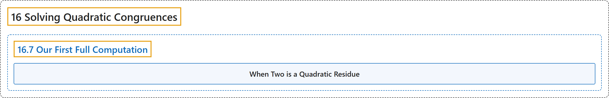

# 16.7 Our First Full Computation

## Classification

## Glossary

| Term | Definition | 中文翻译 | Source |
|---|---|---|---|
| **16.7 Our First Full Computation** 第一次完整计算 | (No definition) | （无定义） | [Crisman, 2024, section 16.7](https://math.gordon.edu/ntic/ntic/section-leg-2-p.html) |
| **When Two is a Quadratic Residue** 2 何时是二次剩余 | "The quadratic residue of two modulo an odd prime $p$ is as follows. **$\left(\frac{2}{p}\right)=1$ if $p\equiv \pm 1$ (mod $8$)** **$\left(\frac{2}{p}\right)=-1$ if $p\equiv \pm 3$ (mod $8$)**" | 2 模奇素数 $p$ 的二次剩余性如下：**$p\equiv \pm 1$（mod $8$）时 $\left(\frac{2}{p}\right)=1$**；**$p\equiv \pm 3$（mod $8$）时 $\left(\frac{2}{p}\right)=-1$** | [Crisman, 2024, Theorem 16.7.1](https://math.gordon.edu/ntic/ntic/section-leg-2-p.html#theorem-qr-two) |

## References

Crisman, K.-D. (2024). *Number theory: In context and interactive* (June 26, 2024 edition). Gordon College. Retrieved October 29, 2026, from <https://math.gordon.edu/ntic/ntic/>
