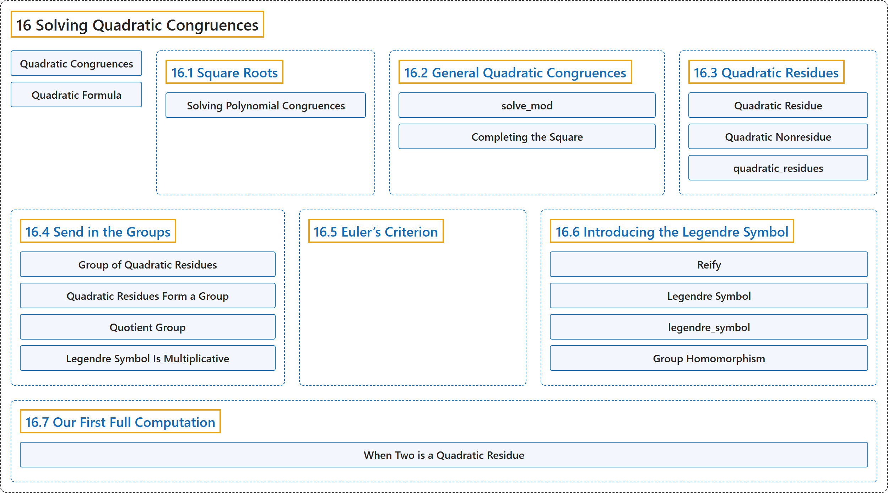

# 16 Solving Quadratic Congruences

## Classification

## Glossary

| Term | Definition | 中文翻译 | Source |
|---|---|---|---|
| **16 Solving Quadratic Congruences** 解二次同余方程 | (No definition) | （无定义） | [Crisman, 2024, chapter 16](https://math.gordon.edu/ntic/ntic/chapter-quadratic-congruences.html) |
| **Quadratic Congruences** 二次同余方程 | "That is the task of solving **quadratic congruences**, **the modular equivalent to the well-known quadratic equations**." | 那就是求解**二次同余方程**的任务，它是**人们熟知的二次方程在模运算中的对应物**。 | [Crisman, 2024, chapter 16](https://math.gordon.edu/ntic/ntic/chapter-quadratic-congruences.html#chapter-quadratic-congruences-2-2) |
| **Quadratic Formula** 求根公式 | "In high school, students worldwide typically use the so-called quadratic formula to solve this: **$x=\frac{-b\pm \sqrt{b^2-4ac}}{2a}$**." | 在中学，世界各地的学生通常用所谓的求根公式来解它：**$x=\frac{-b\pm \sqrt{b^2-4ac}}{2a}$**。 | [Crisman, 2024, chapter 16](https://math.gordon.edu/ntic/ntic/chapter-quadratic-congruences.html#chapter-quadratic-congruences-2-3) |
| **[16.1 Square Roots](16-1-square-roots.md)** 平方根 | (No definition) | （无定义） | [Crisman, 2024, section 16.1](https://math.gordon.edu/ntic/ntic/section-square-roots.html) |
| **[16.2 General Quadratic Congruences](16-2-general-quadratic-congruences.md)** 一般二次同余方程 | (No definition) | （无定义） | [Crisman, 2024, section 16.2](https://math.gordon.edu/ntic/ntic/section-quadratic-congruences.html) |
| **[16.3 Quadratic Residues](16-3-quadratic-residues.md)** 二次剩余 | (No definition) | （无定义） | [Crisman, 2024, section 16.3](https://math.gordon.edu/ntic/ntic/section-quad-residues.html) |
| **[16.4 Send in the Groups](16-4-send-in-the-groups.md)** 引入群 | (No definition) | （无定义） | [Crisman, 2024, section 16.4](https://math.gordon.edu/ntic/ntic/section-quad-groups.html) |
| **[16.5 Euler’s Criterion](16-5-eulers-criterion.md)** 欧拉判别法 | (No definition) | （无定义） | [Crisman, 2024, section 16.5](https://math.gordon.edu/ntic/ntic/section-euler-crit.html) |
| **[16.6 Introducing the Legendre Symbol](16-6-introducing-the-legendre-symbol.md)** 勒让德符号简介 | (No definition) | （无定义） | [Crisman, 2024, section 16.6](https://math.gordon.edu/ntic/ntic/section-legendre-symb.html) |
| **[16.7 Our First Full Computation](16-7-our-first-full-computation.md)** 第一次完整计算 | (No definition) | （无定义） | [Crisman, 2024, section 16.7](https://math.gordon.edu/ntic/ntic/section-leg-2-p.html) |

## References

Crisman, K.-D. (2024). *Number theory: In context and interactive* (June 26, 2024 edition). Gordon College. Retrieved October 29, 2026, from <https://math.gordon.edu/ntic/ntic/>
