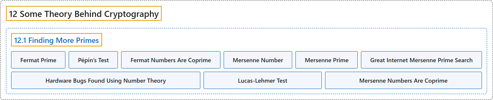

# 12.1 Finding More Primes

## Classification

## Glossary

| Term | Definition | 中文翻译 | Source |
|---|---|---|---|
| **12.1 Finding More Primes** 寻找更多素数 | (No definition) | （无定义） | [Crisman, 2024, section 12.1](https://math.gordon.edu/ntic/ntic/section-finding-primes.html) |
| **Fermat Prime** 费马素数 | "Recall (Subsection 11.5.1) that our friend Pierre de Fermat thought that **numbers of the form $2^{2^n}+1$ would always be prime** – numbers such as $5$, $17$, and $257$." | 回忆一下（11.5.1 小节），我们的朋友皮埃尔德费马认为**形如 $2^{2^n}+1$ 的数总是素数**，比如 $5$、$17$ 和 $257$。 | [Crisman, 2024, subsection 12.1.1](https://math.gordon.edu/ntic/ntic/section-finding-primes.html#subsection-fermat-primes-2) |
| **Pépin’s Test** 佩潘检验 | "There is **a special test** called **Pépin’s test** that **tests Fermat numbers for primality**. It is equivalent to checking whether $3$ is a primitive root of $2^{2^n}+1$." | 有一种称为**佩潘检验**的**专门检验**，用来**检验费马数是否为素数**。它等价于检验 $3$ 是否是 $2^{2^n}+1$ 的原根。 | [Crisman, 2024, subsection 12.1.1](https://math.gordon.edu/ntic/ntic/section-finding-primes.html#subsection-fermat-primes-7) |
| **Fermat Numbers Are Coprime** 费马数两两互素 | "**$F_n=2^{2^n}+1$ and $F_m=2^{2^m}+1$ are coprime if $m\neq n$.**" | **若 $m\neq n$，则 $F_n=2^{2^n}+1$ 与 $F_m=2^{2^m}+1$ 互素**。 | [Crisman, 2024, Proposition 12.1.4](https://math.gordon.edu/ntic/ntic/section-finding-primes.html#prop-fermat-coprime) |
| **Mersenne Number** 梅森数 | "In general, numbers of the form $M_n=2^n-1$ are called **Mersenne numbers**. If they are prime, they are called **Mersenne primes**." | 一般地，形如 $M_n=2^n-1$ 的数称为**梅森数**。如果它们是素数，就称为**梅森素数**。 | [Crisman, 2024, Definition 12.1.6](https://math.gordon.edu/ntic/ntic/section-finding-primes.html#definition-mersenne-numbers) |
| **Mersenne Prime** 梅森素数 | "In general, numbers of the form $M_n=2^n-1$ are called **Mersenne numbers**. If they are prime, they are called **Mersenne primes**." | 一般地，形如 $M_n=2^n-1$ 的数称为**梅森数**。如果它们是素数，就称为**梅森素数**。 | [Crisman, 2024, Definition 12.1.6](https://math.gordon.edu/ntic/ntic/section-finding-primes.html#definition-mersenne-numbers) |
| **Great Internet Mersenne Prime Search** 因特网梅森素数大搜索 | "You can help the world search for more Mersenne primes if you leave your personal computer on and connected to the Internet, via the **Great Internet Mersenne Prime Search** (GIMPS)." | 只要让你的个人电脑开着并连上因特网，你就可以通过**因特网梅森素数大搜索**（GIMPS）帮助全世界寻找更多的梅森素数。 | [Crisman, 2024, Historical remark 12.1.7](https://math.gordon.edu/ntic/ntic/section-finding-primes.html#remark-GIMPS) |
| **Hardware Bugs Found Using Number Theory** 用数论发现的硬件缺陷 | "A less obvious but interesting application is that **searching for very large primes can also help more mundane hardware testing**." | 一个不那么明显但有趣的应用是，**寻找非常大的素数也能帮助更日常的硬件测试**。 | [Crisman, 2024, Historical remark 12.1.8](https://math.gordon.edu/ntic/ntic/section-finding-primes.html#remark-gimps-skylake) |
| **Lucas-Lehmer Test** 卢卡斯-莱默检验 | "Let $x_0=4$ and let $p$ be prime (greater than $2$). To test whether $2^p-1$ is prime, create the list of numbers $x_{n+1}=\text{residue of }x_n^2-2\text{ modulo }2^p-1$ Do this $p-2$ times; if the result $x_{p-2}$ is divisible by $2^p-1$ (i.e., is zero modulo $2^p-1$), then **$2^p-1$ is in fact prime**." | 令 $x_0=4$，$p$ 为素数（大于 $2$）。要检验 $2^p-1$ 是否为素数，构造数列 $x_{n+1}=\text{residue of }x_n^2-2\text{ modulo }2^p-1$（$x_n^2-2$ 模 $2^p-1$ 的余数）。这样做 $p-2$ 次；若结果 $x_{p-2}$ 能被 $2^p-1$ 整除（即模 $2^p-1$ 为零），那么 **$2^p-1$ 就是素数**。 | [Crisman, 2024, Algorithm 12.1.9](https://math.gordon.edu/ntic/ntic/section-finding-primes.html#algorithm-lucas-lehmer) |
| **Mersenne Numbers Are Coprime** 梅森数互素 | "**Mersenne numbers $2^p-1$ and $2^q-1$ with coprime exponents are themselves coprime.**" | **指数互素的梅森数 $2^p-1$ 与 $2^q-1$ 本身也互素**。 | [Crisman, 2024, Proposition 12.1.11](https://math.gordon.edu/ntic/ntic/section-finding-primes.html#prop-mersenne-coprime) |

## References

Crisman, K.-D. (2024). *Number theory: In context and interactive* (June 26, 2024 edition). Gordon College. Retrieved October 29, 2026, from <https://math.gordon.edu/ntic/ntic/>
